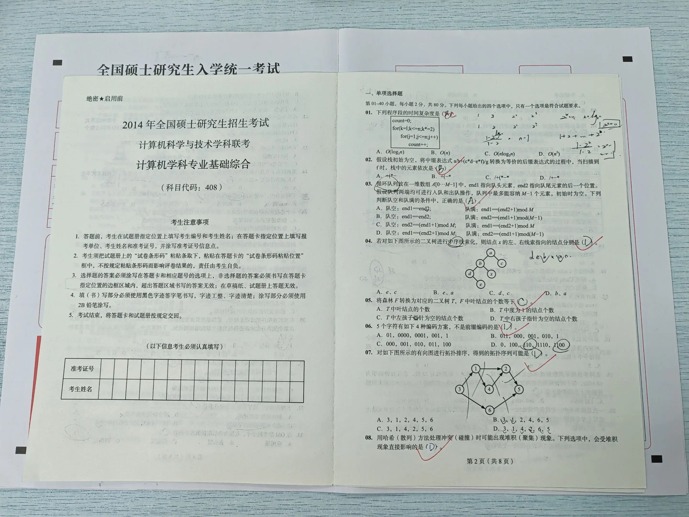
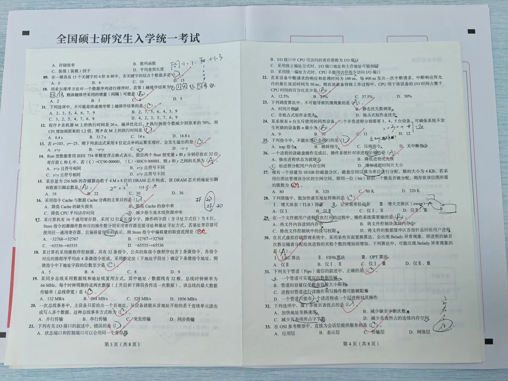
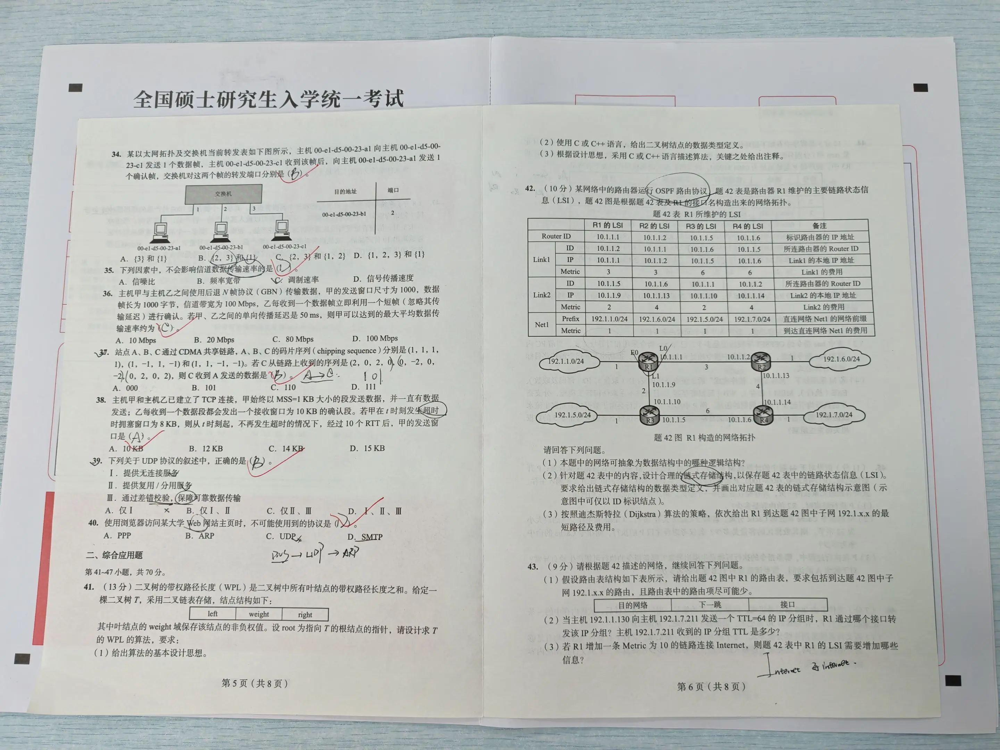
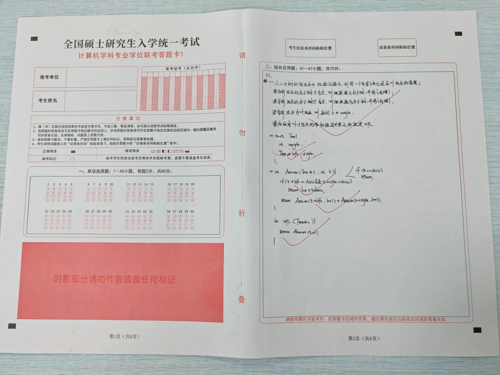
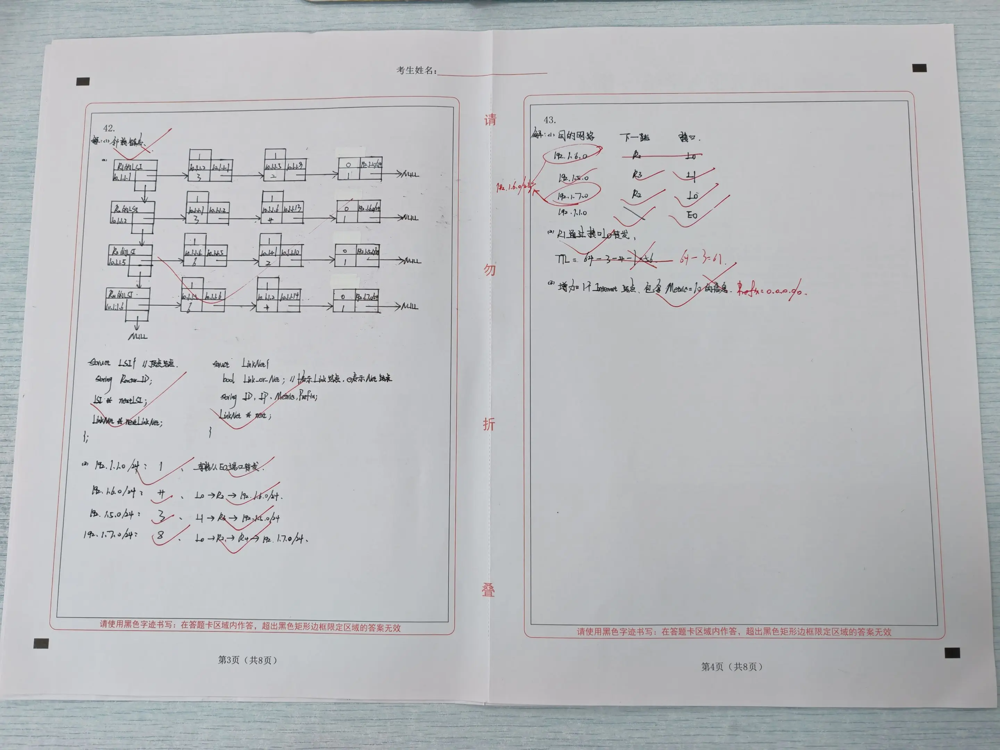
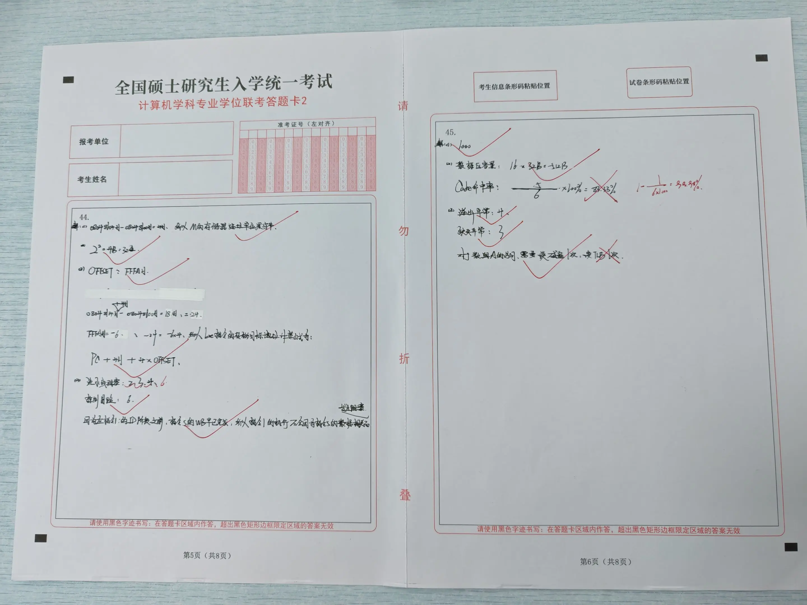
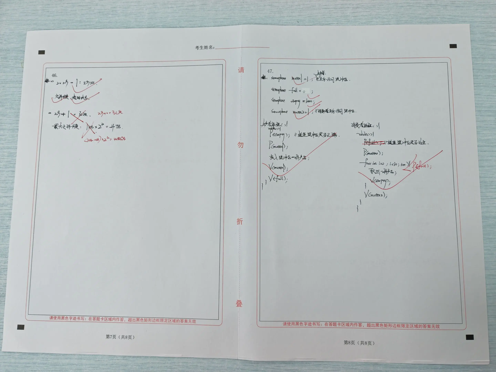

# 408 · 真题 · 2014年

[返回主页](../../../README.md)

### 2014年408 2h10min 125

发布于：2026-10-07（北京时间，非作答日期）  
[原作品](https://www.douyin.com/note/7693868863952491505)

原标题全文：

> 2014年408 2h10min 125。#考研 #考研上岸 #408

