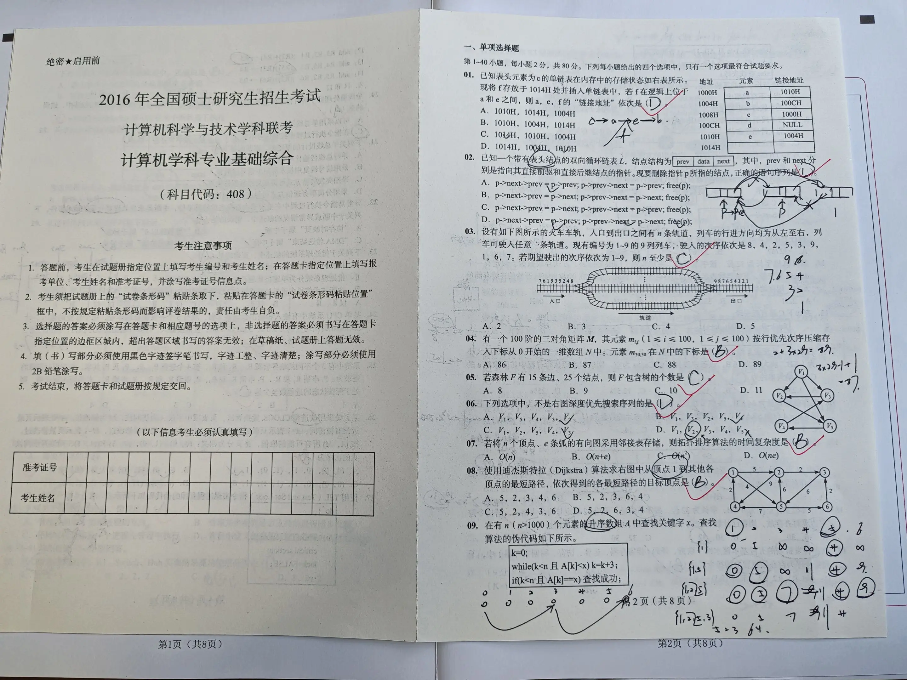
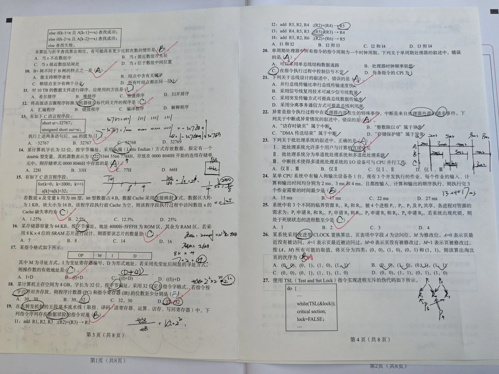
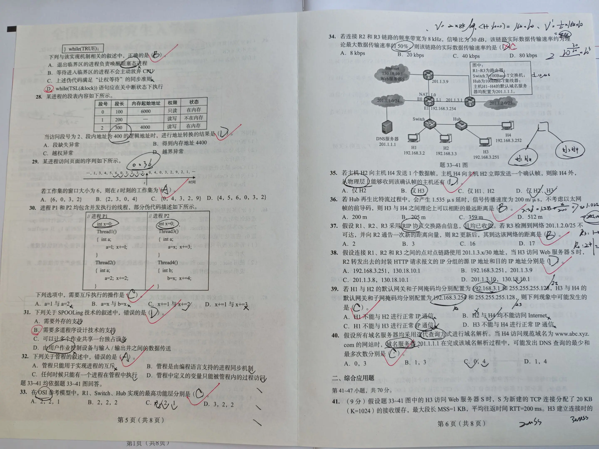
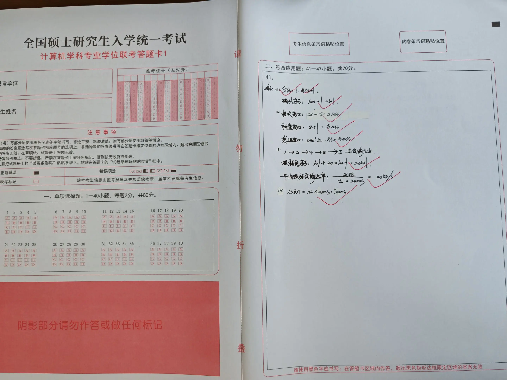
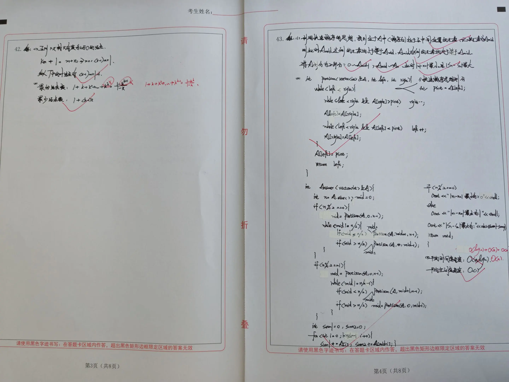
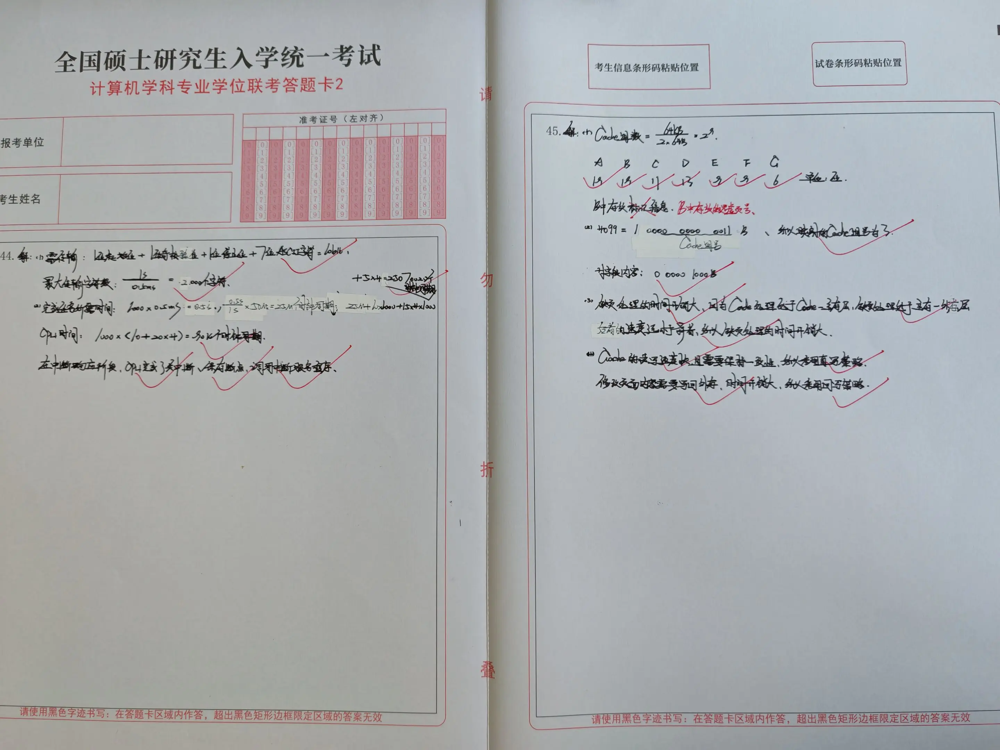
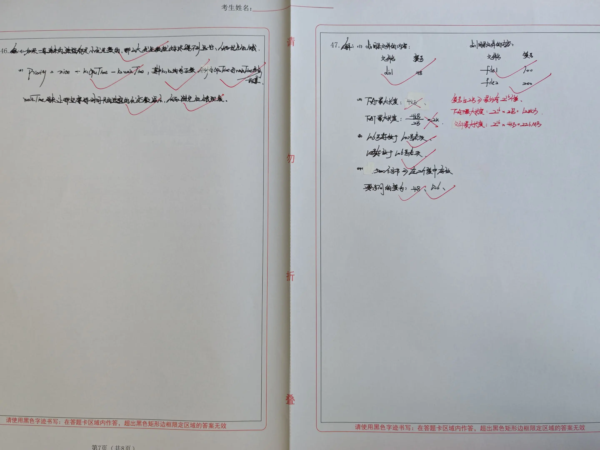

# 408 · 真题 · 2016年

[返回主页](../../../README.md)

### 2016年408 2h20min135分

发布于：2026-09-06（北京时间，非作答日期）  
[原作品](https://www.douyin.com/note/7682351656772464869)

原标题全文：

> 2016年408 2h20min135分。#考研 #考研上岸 #408

