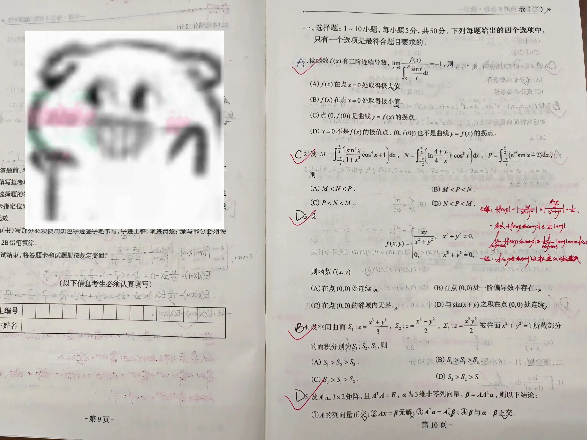
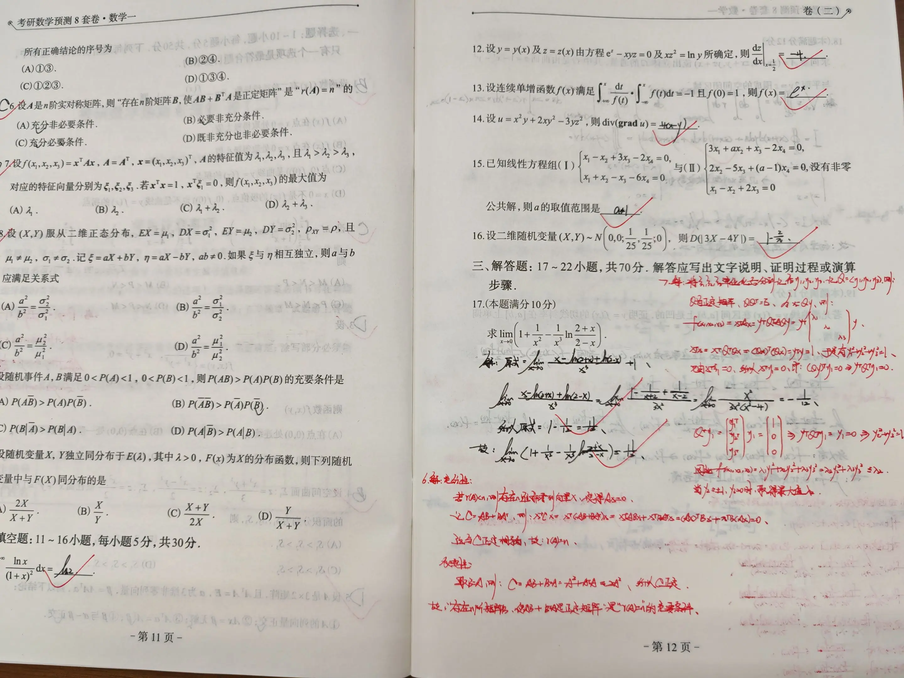
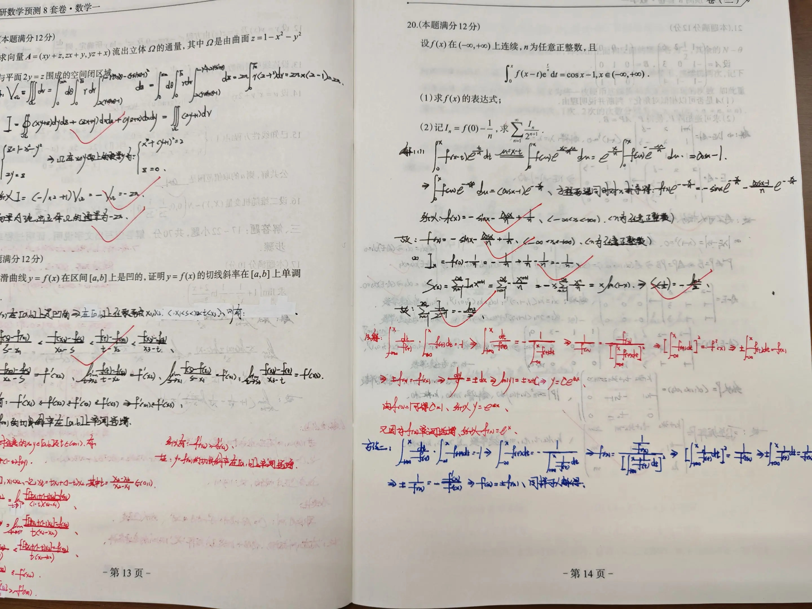
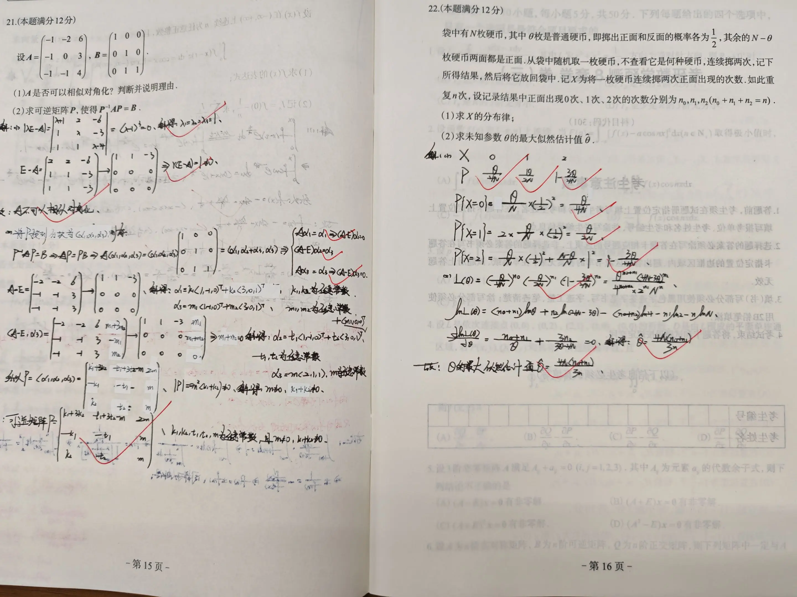

# 数学 · 模拟题 · 2027年 · 张宇 · 八套卷 · 卷二

[返回主页](../../../../../../README.md)

### 2027张八卷二2h30min 140分

发布于：2026-09-09（北京时间，非作答日期）  
[原作品](https://www.douyin.com/note/7683374491636494267)

原标题全文：

> 2027张八卷二2h30min 140分。#考研 #考研上岸 #张宇

