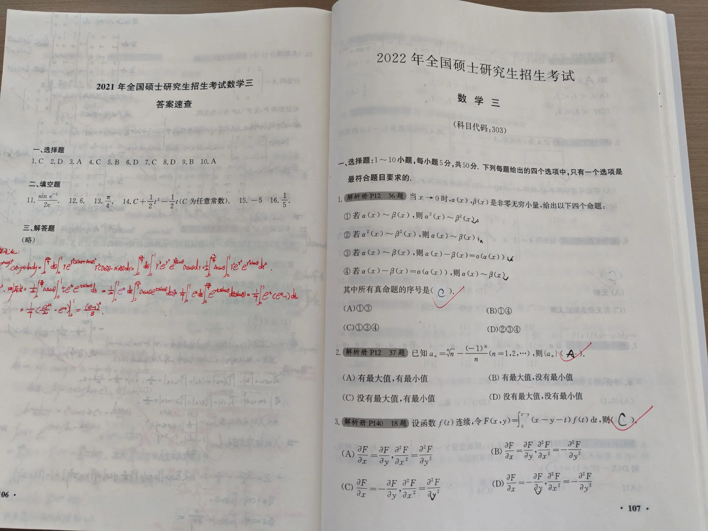
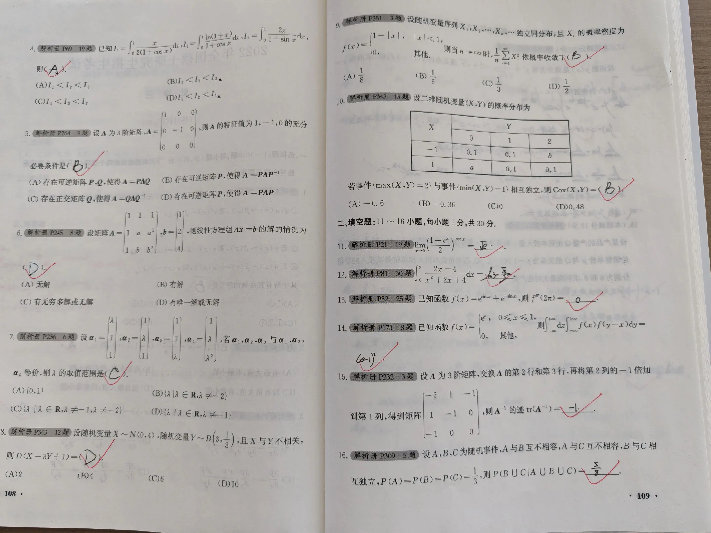
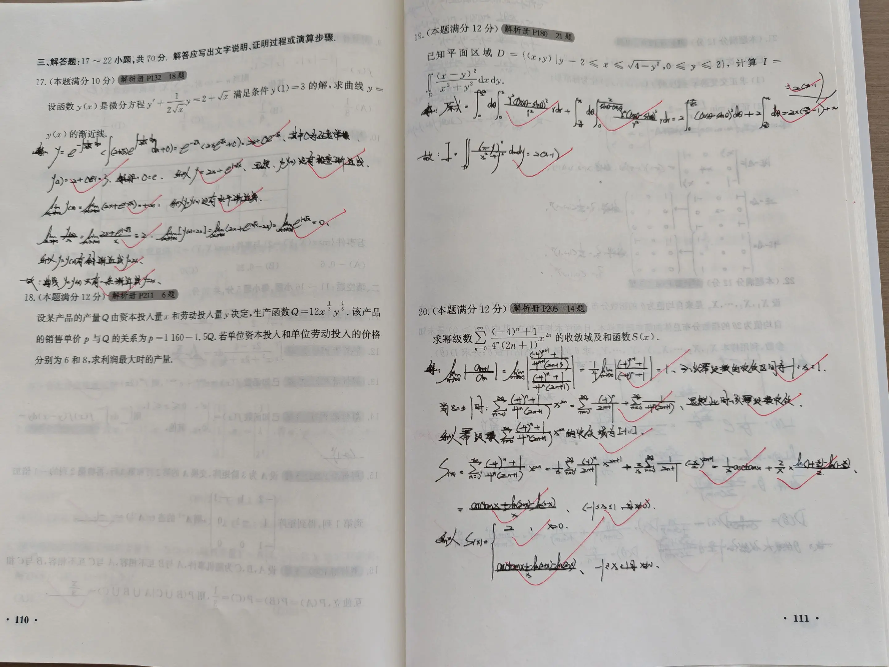
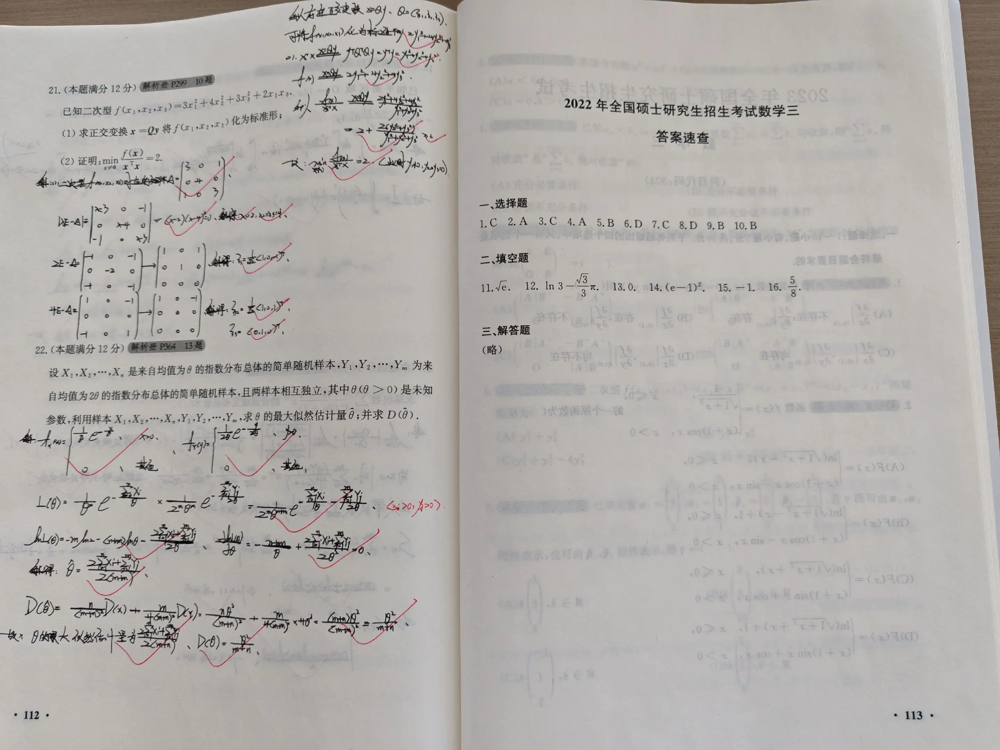

# 数学 · 真题 · 数学三 · 2022年

[返回主页](../../../../README.md)

### 2022年数三1h30min 138-5

发布于：2026-09-18（北京时间，非作答日期）  
[原作品](https://www.douyin.com/note/7686702056946983153)

原标题全文：

> 2022年数三1h30min 138-5。#考研 #考研上岸 #刷数学真题

成绩解释：适用满分 138 分，扣 5 分，实际得分 **133 分**。

