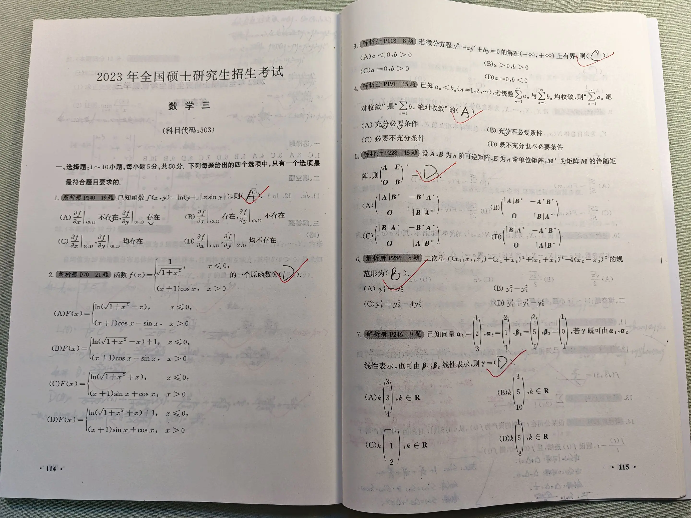
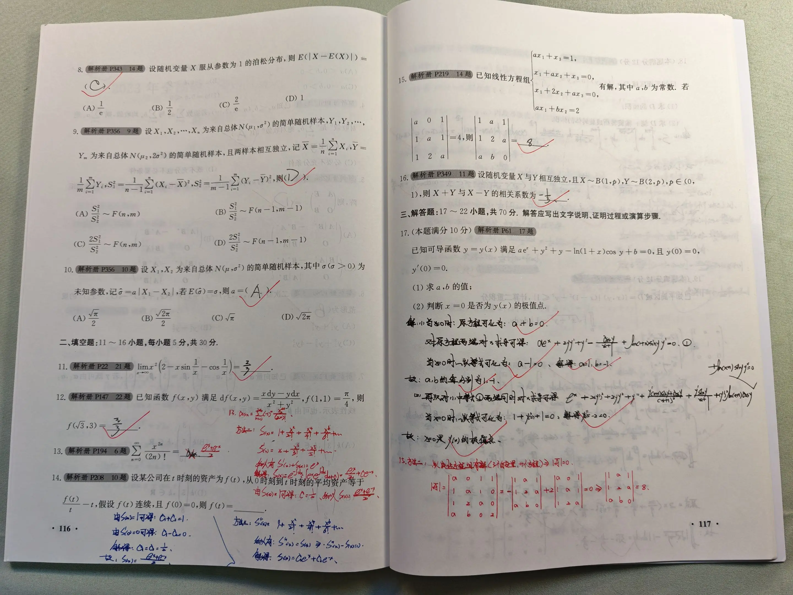
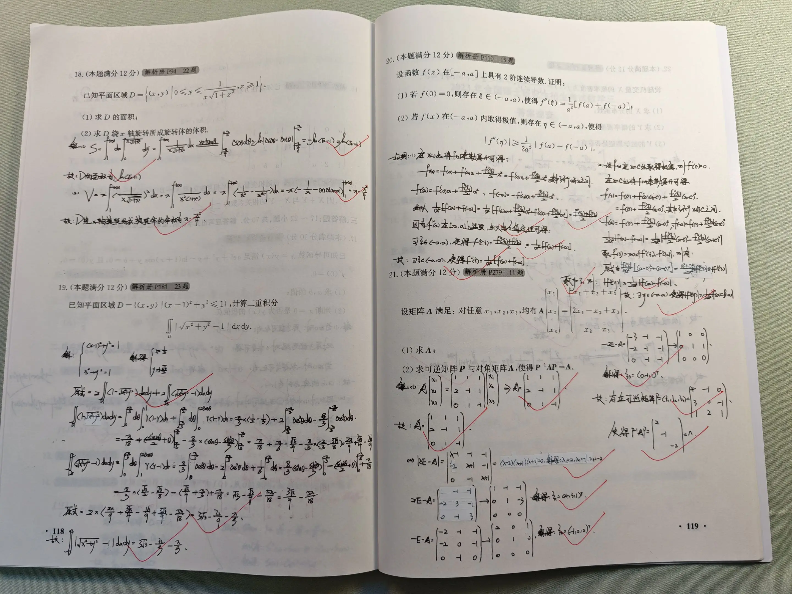
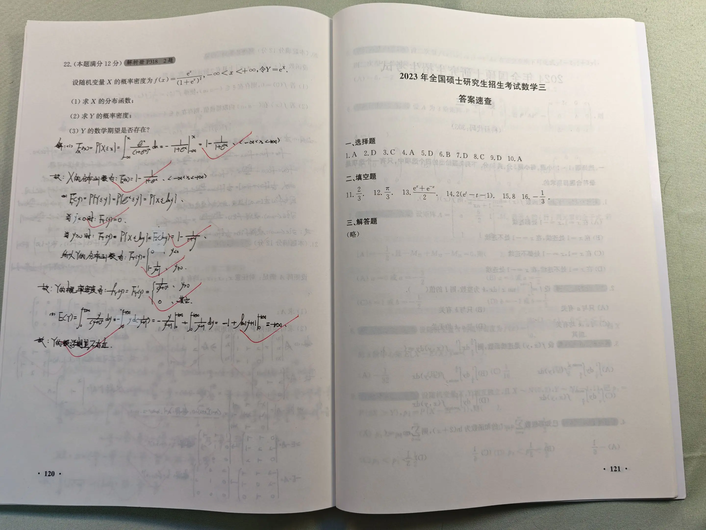

# 数学 · 真题 · 数学三 · 2023年

[返回主页](../../../../README.md)

### 2023年数三2h 145-5

发布于：2026-09-25（北京时间，非作答日期）  
[原作品](https://www.douyin.com/note/7689299130116254641)

原标题全文：

> 2023年数三2h 145-5。#考研 #考研上岸 #数三

成绩解释：适用满分 145 分，扣 5 分，实际得分 **140 分**。

