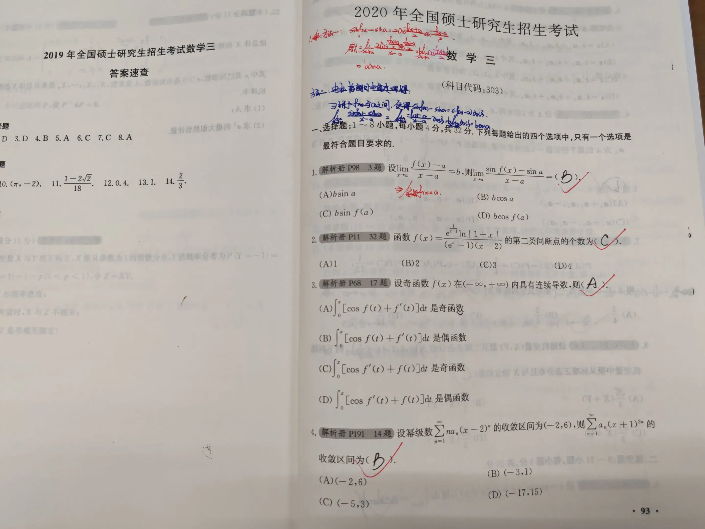
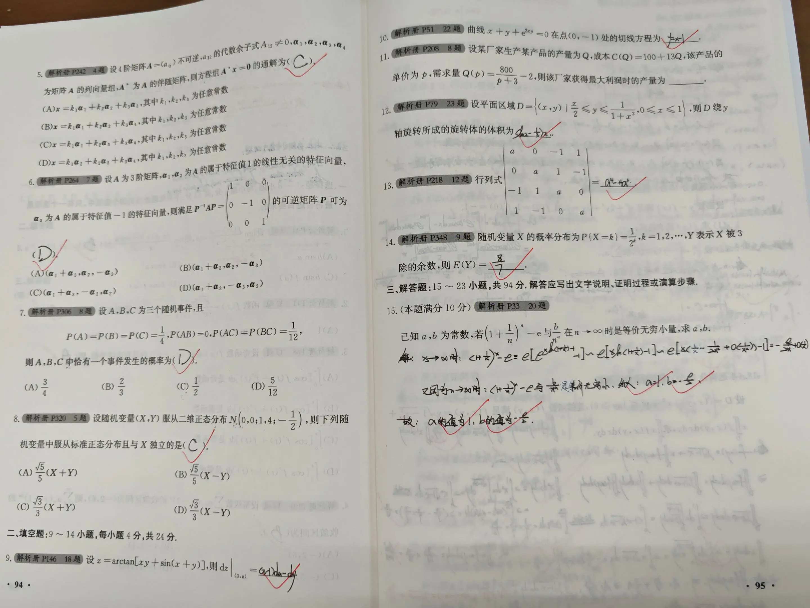
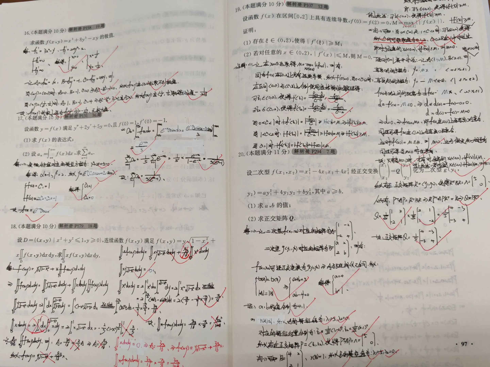
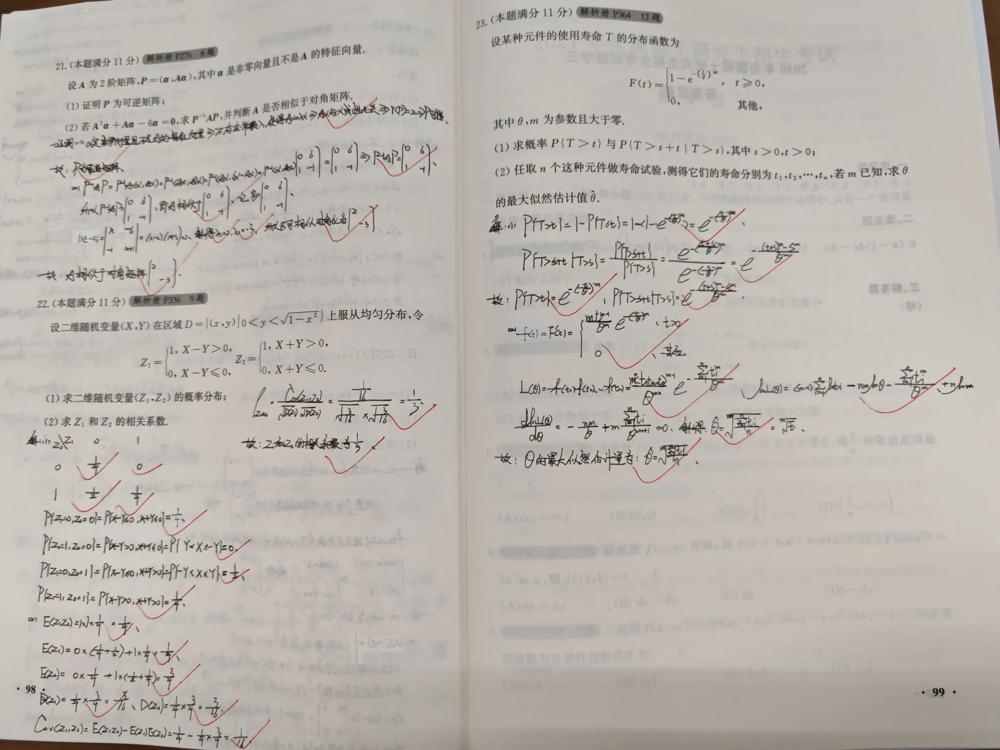

# 数学一 · 拓展训练 · 数学三 · 真题 · 2020年

[返回主页](../../../../../README.md)

### 2020年数三2h20min145-10

发布于：2026-09-03（北京时间，非作答日期）  
[原作品](https://www.douyin.com/note/7681219760587697849)

原标题全文：

> 2020年数三2h20min145-10。#考研 #考研上岸

成绩解释：适用满分 145 分，扣 10 分，实际得分 **135 分**。

