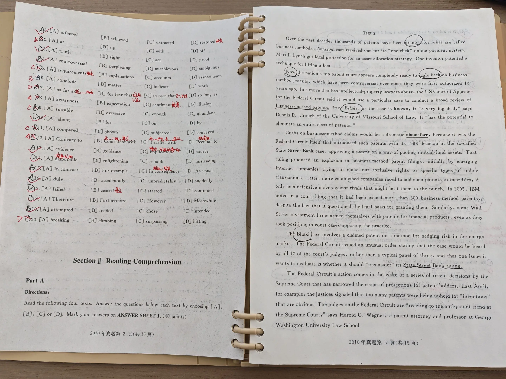
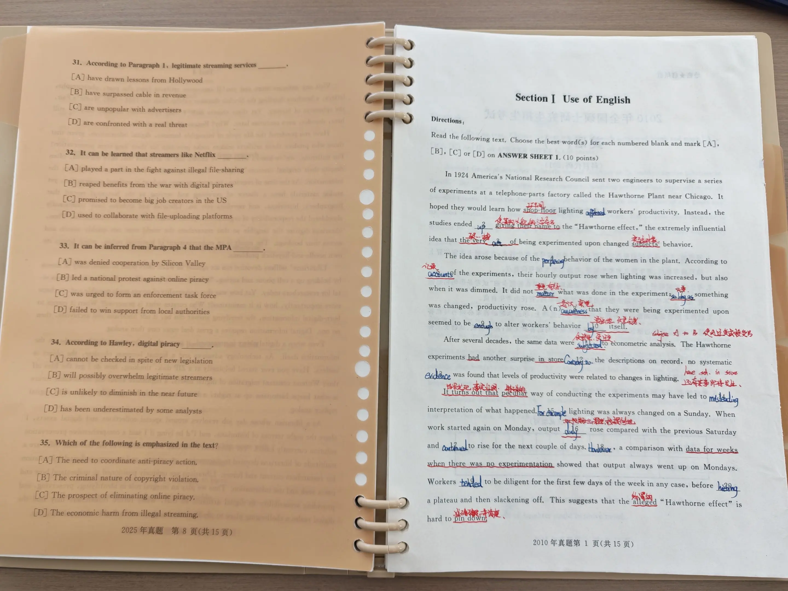

# 英语一 · 真题 · 2010年 · 完形填空

[返回主页](../../../../README.md)

### 2010年英一完形填空 11/20

发布于：2026-11-04（北京时间，非作答日期）  
[原作品](https://www.douyin.com/note/7704146539535964666)

原标题全文：

> 2010年英一完形填空 11/20。#考研 #考研上岸 #英一 #完形填空

