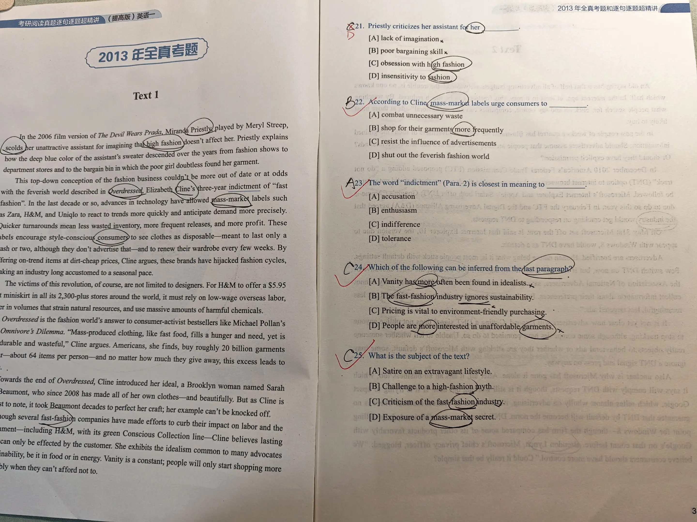
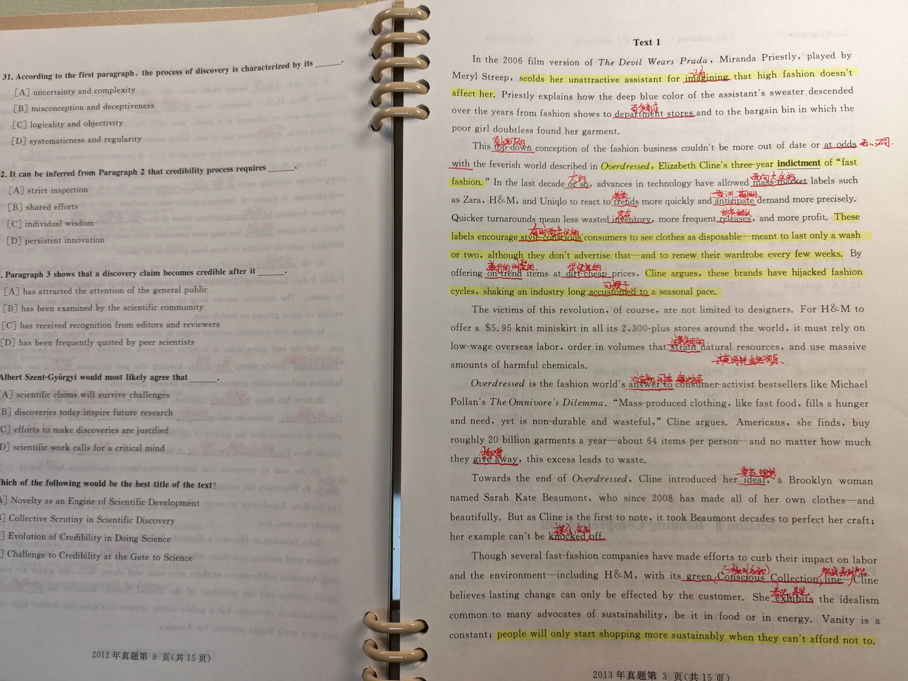
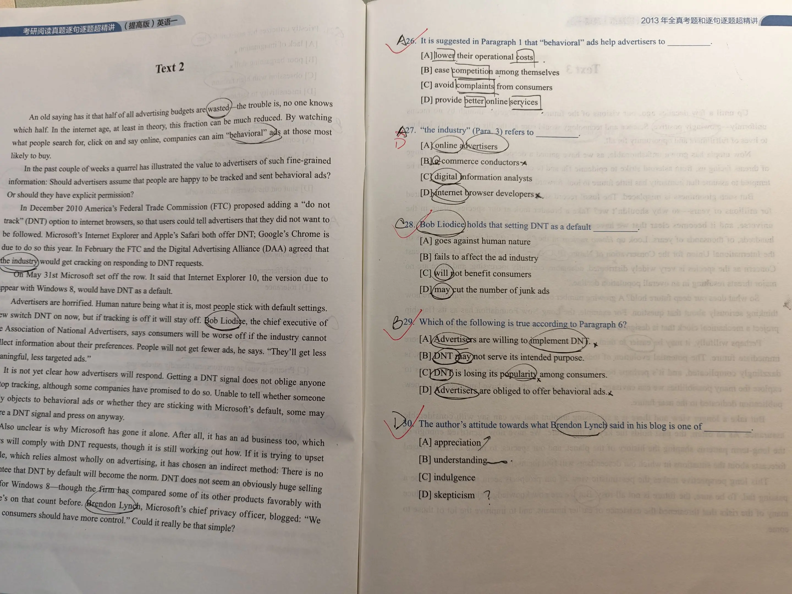
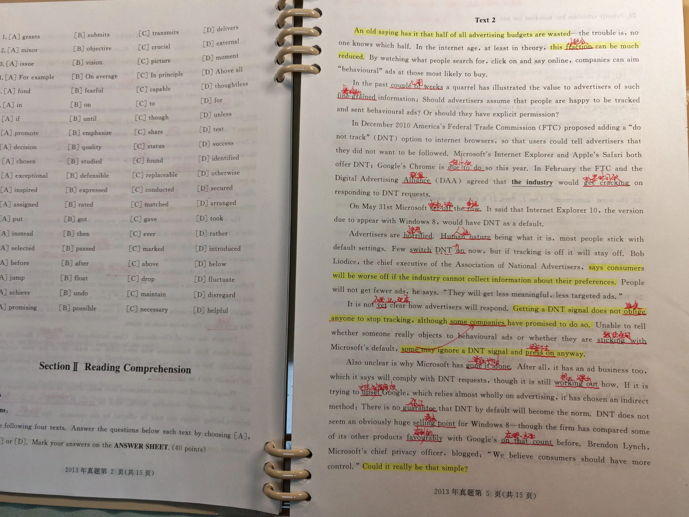
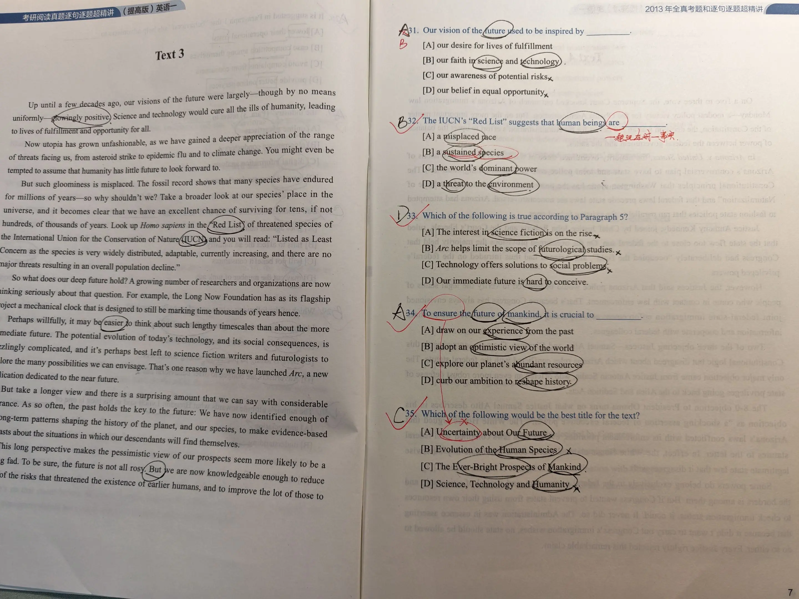
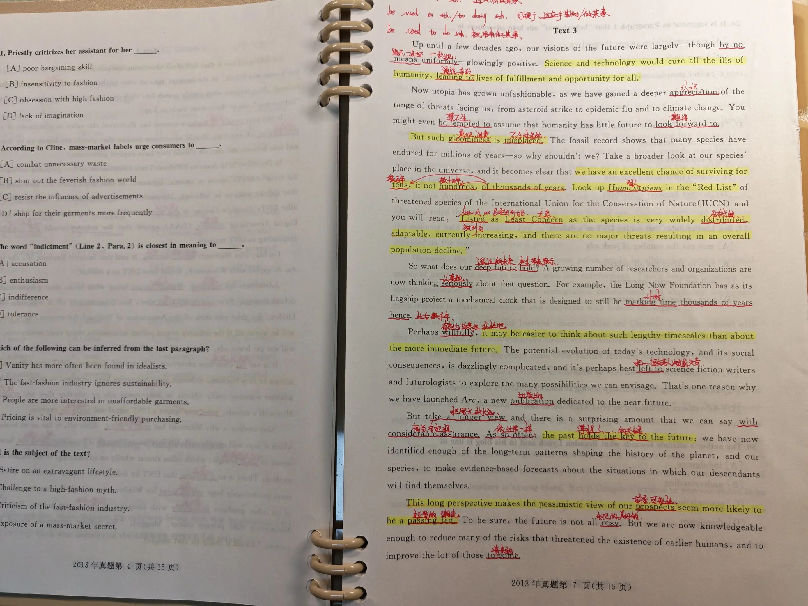
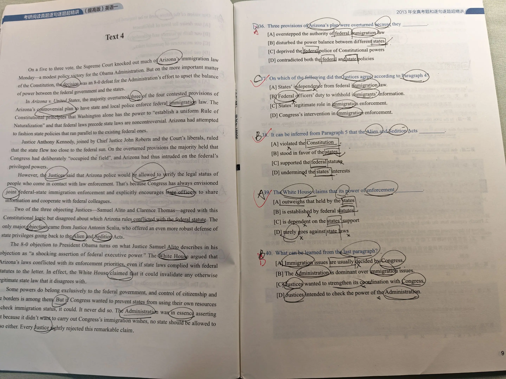
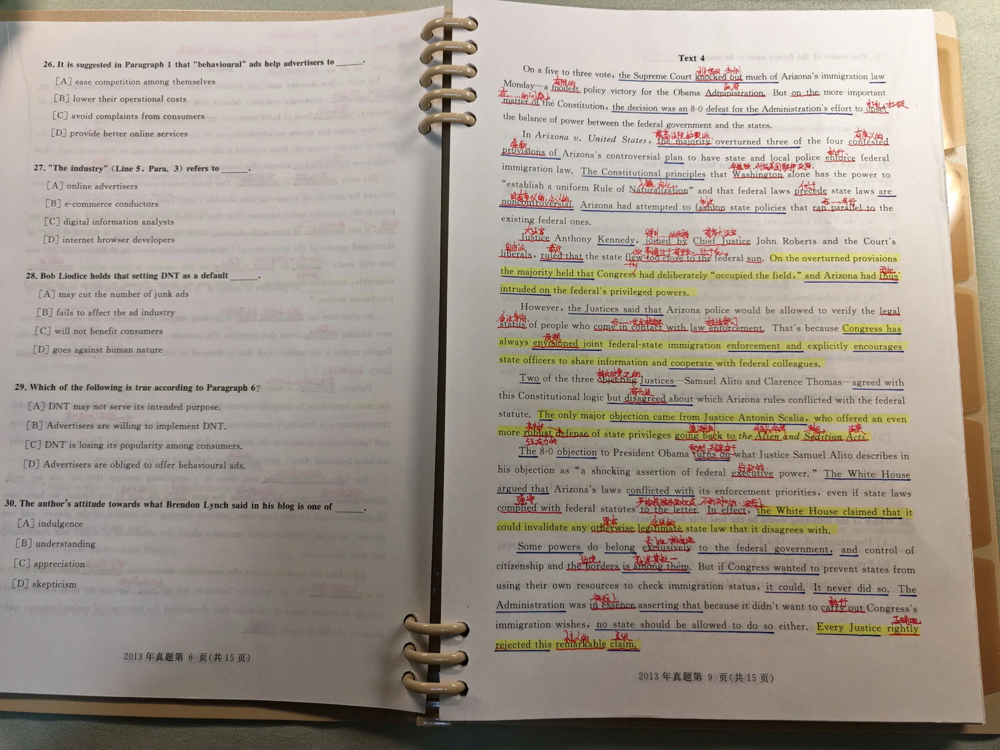

# 英语一 · 真题 · 2013年 · 阅读

[返回主页](../../../../README.md)

### 2013年英一Text1 4/5

发布于：2026-09-19（北京时间，非作答日期）  
[原作品](https://www.douyin.com/note/7687261382902949553)

原标题全文：

> 2013年英一Text1 4/5。#考研 #考研上岸 #英一

### 2013年英一Text2 4/5

发布于：2026-09-19（北京时间，非作答日期）  
[原作品](https://www.douyin.com/note/7687261554614282618)

原标题全文：

> 2013年英一Text2 4/5。#考研 #考研上岸 #英一

### 2013年英一Text3 4/5

发布于：2026-09-19（北京时间，非作答日期）  
[原作品](https://www.douyin.com/note/7687261734432064698)

原标题全文：

> 2013年英一Text3 4/5。#考研 #考研上岸 #英一#英一

### 2013年英一Text4 3/5

发布于：2026-09-20（北京时间，非作答日期）  
[原作品](https://www.douyin.com/note/7687644444481598641)

原标题全文：

> 2013年英一Text4 3/5。#考研 #考研上岸 #英一#英一

