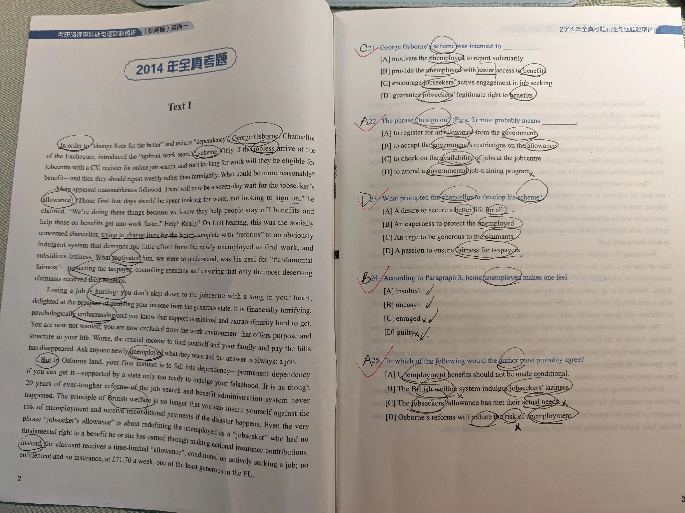
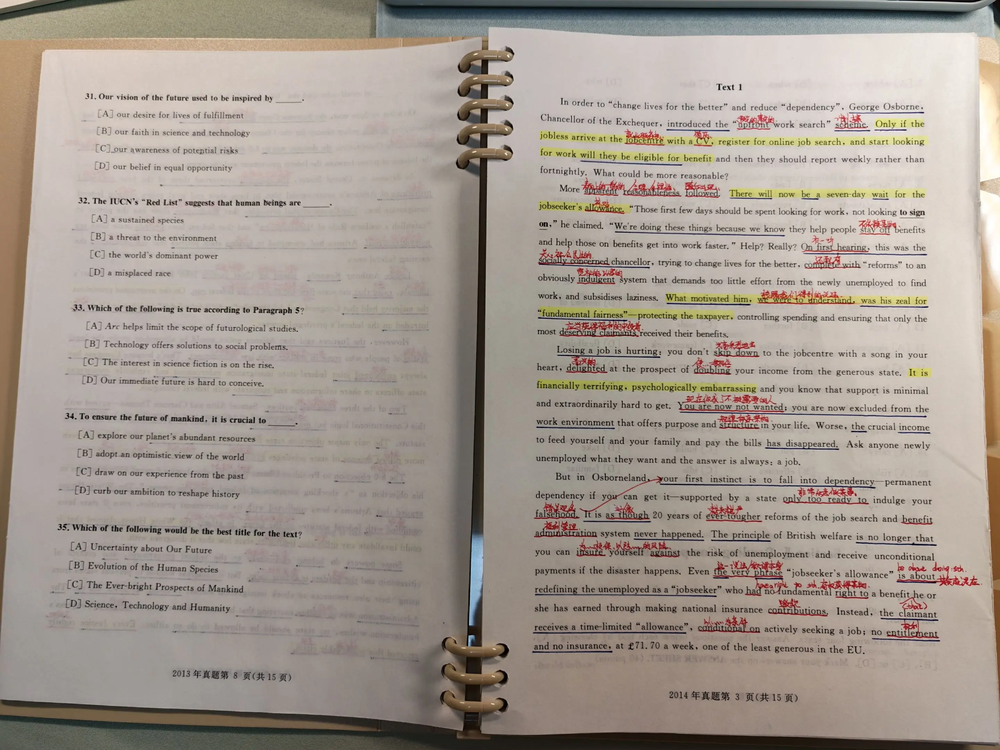
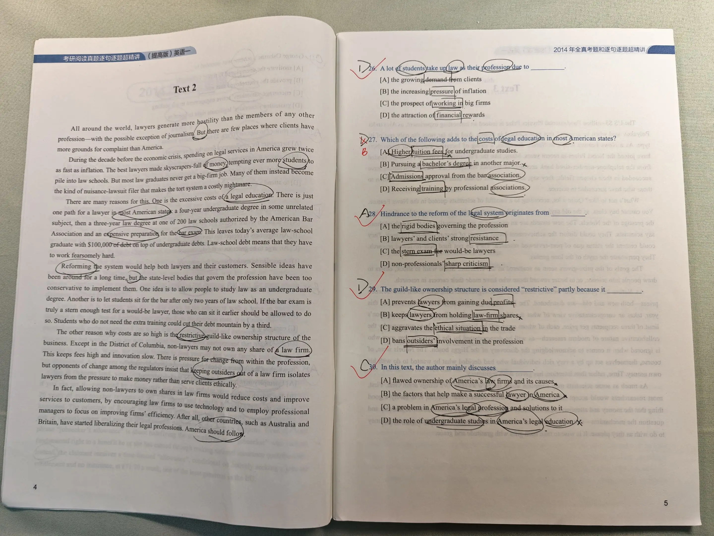
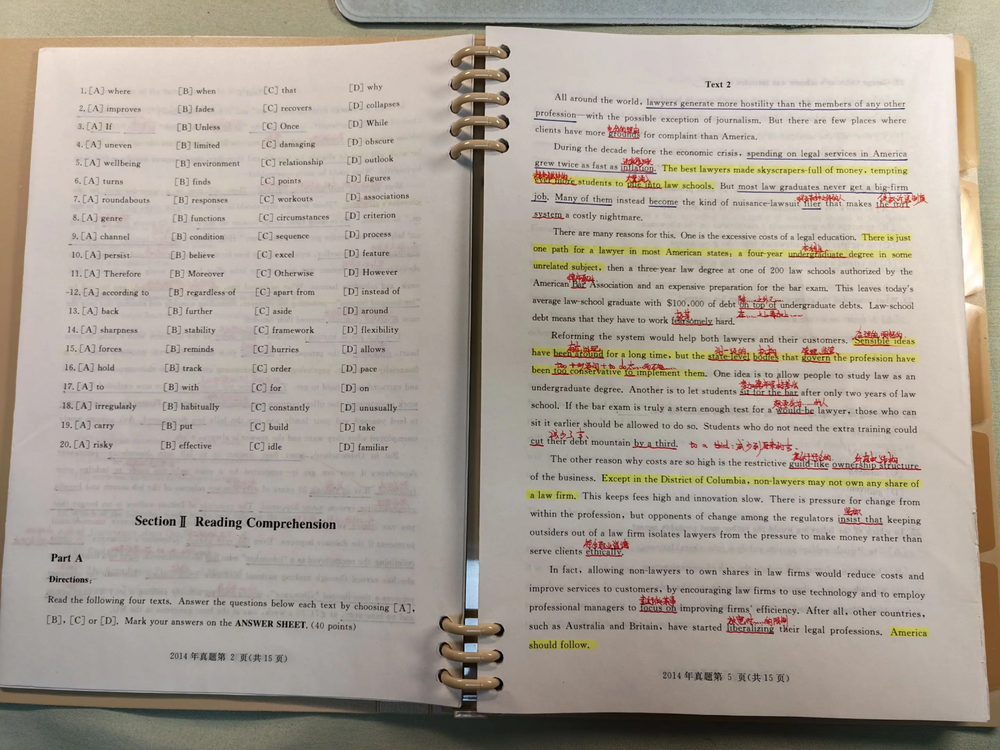
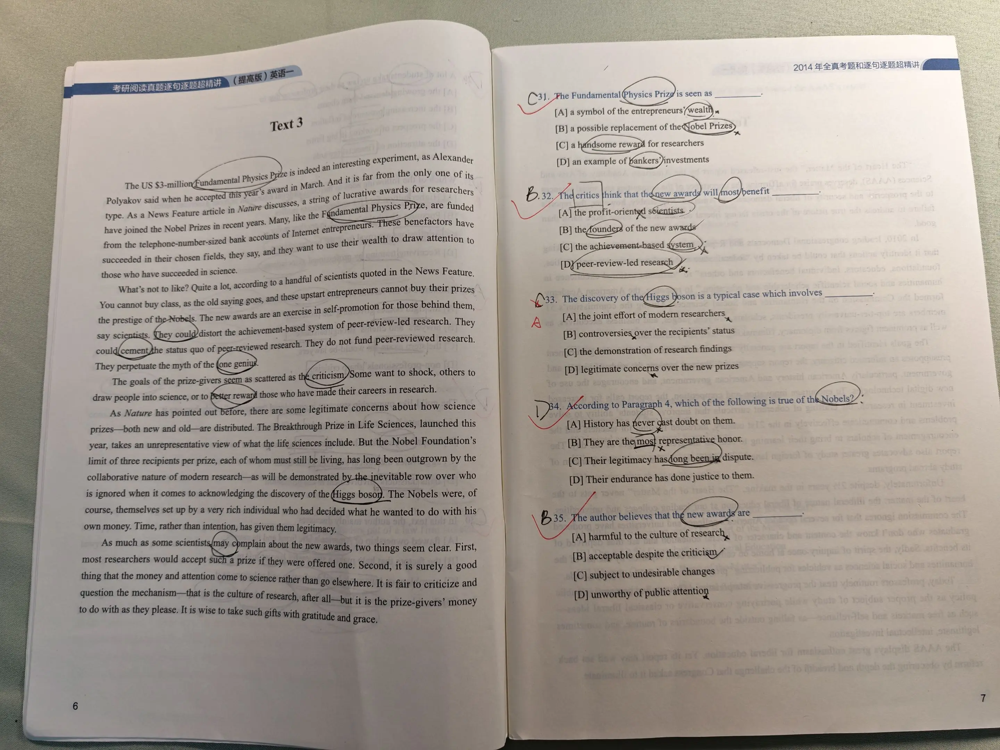
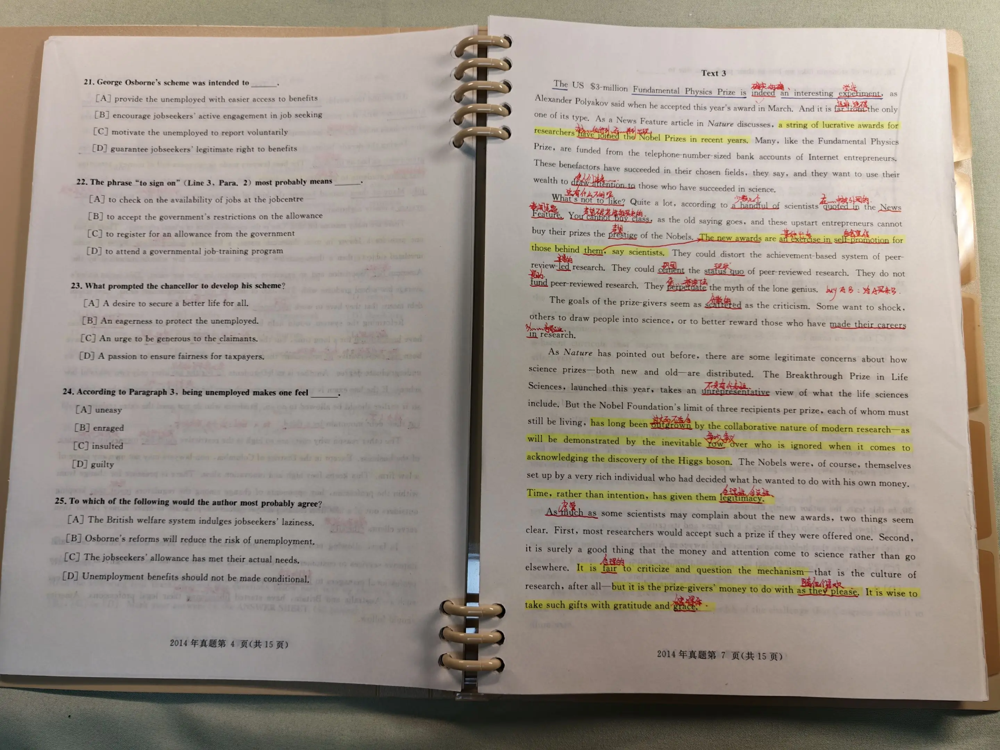
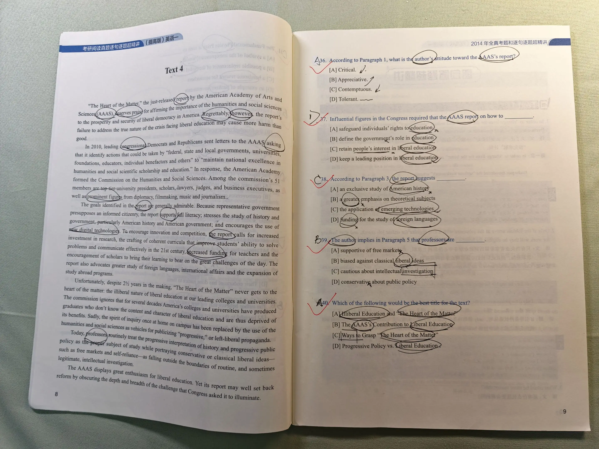
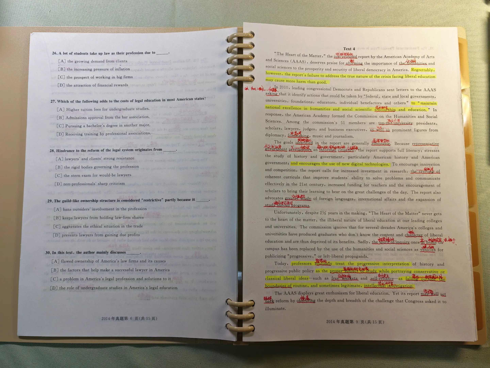

# 英语一 · 真题 · 2014年 · 阅读

[返回主页](../../../../README.md)

### 2014年英一Text1 5/5

发布于：2026-09-22（北京时间，非作答日期）  
[原作品](https://www.douyin.com/note/7688365634140307322)

原标题全文：

> 2014年英一Text1 5/5。#考研 #考研上岸 #英一阅读

### 2014年英一Text2 4/5

发布于：2026-09-23（北京时间，非作答日期）  
[原作品](https://www.douyin.com/note/7688740869390722235)

原标题全文：

> 2014年英一Text2 4/5。#考研 #考研上岸 #英一

### 2014年Text3 4/5

发布于：2026-09-25（北京时间，非作答日期）  
[原作品](https://www.douyin.com/note/7689136248506525425)

原标题全文：

> 2014年Text3 4/5。#考研 #考研上岸 #英一

### 2014年英一Text4 5/5

发布于：2026-09-26（北京时间，非作答日期）  
[原作品](https://www.douyin.com/note/7689863073575228581)

原标题全文：

> 2014年英一Text4 5/5。#考研 #考研上岸 #英一

