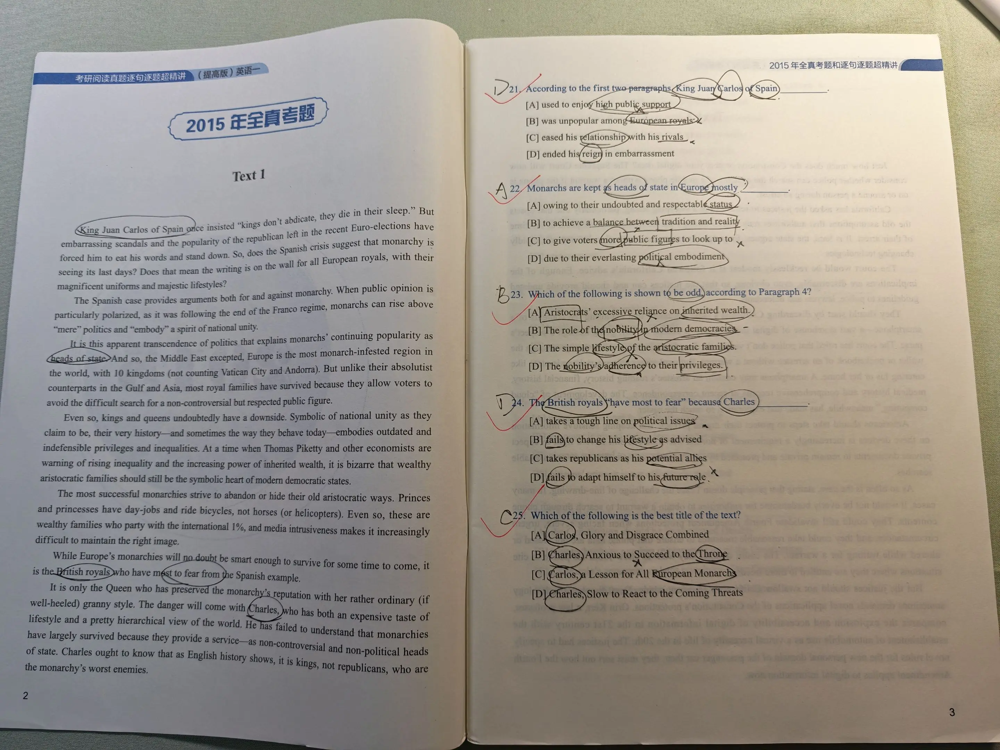
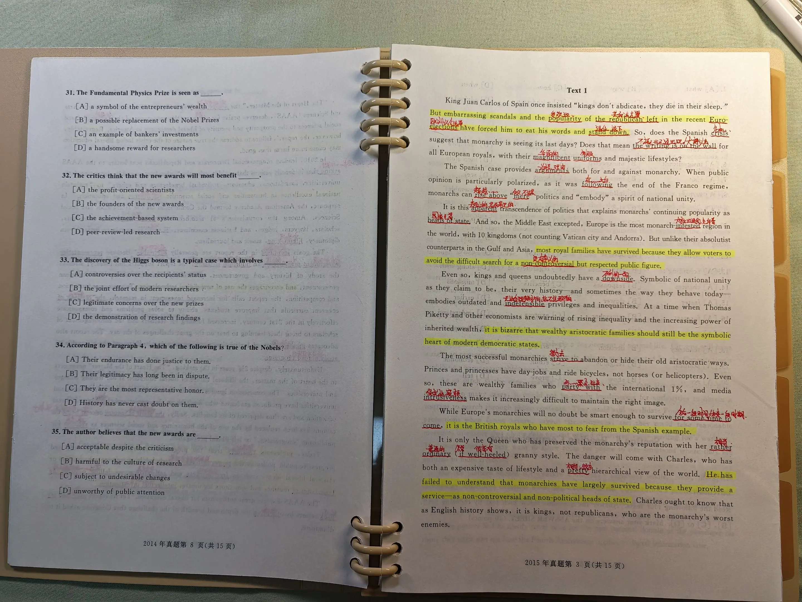
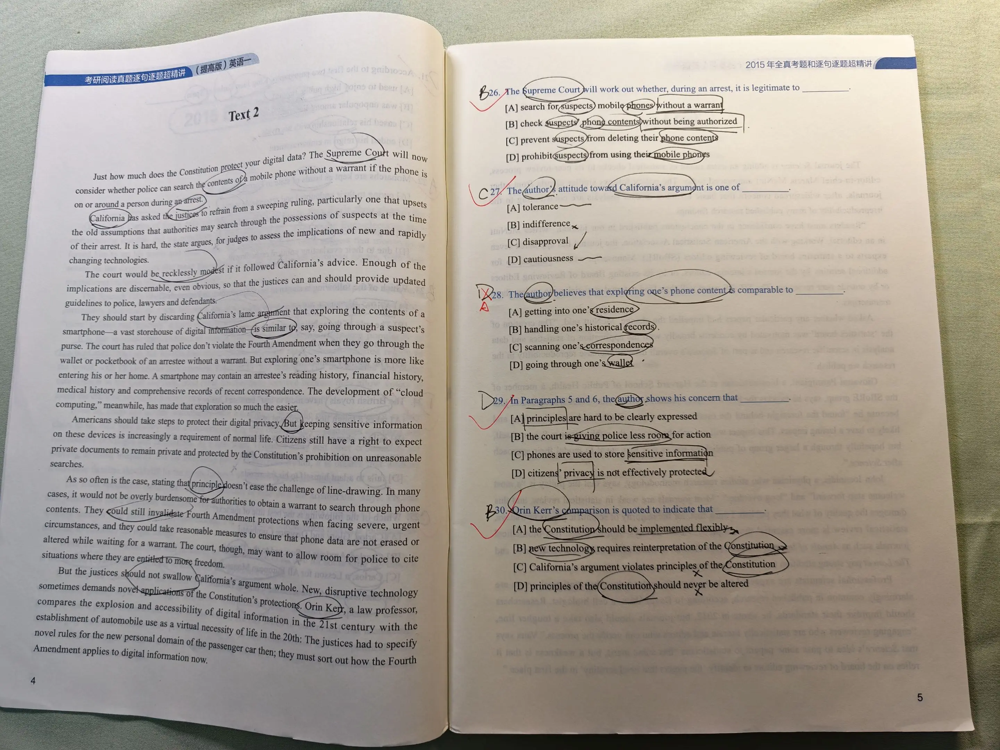
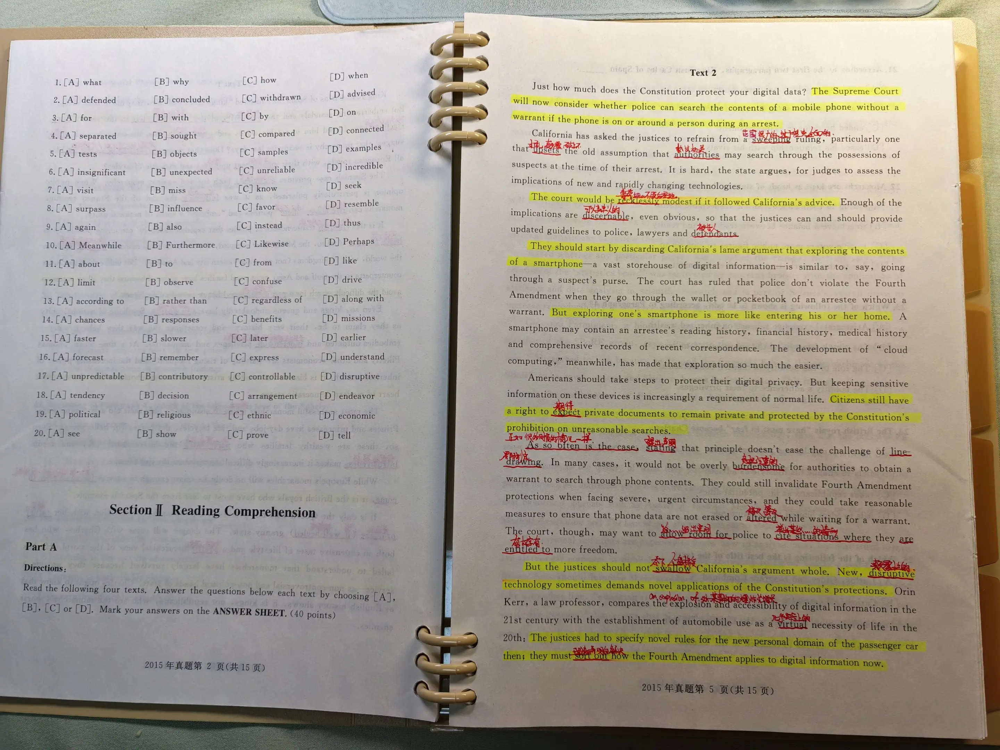
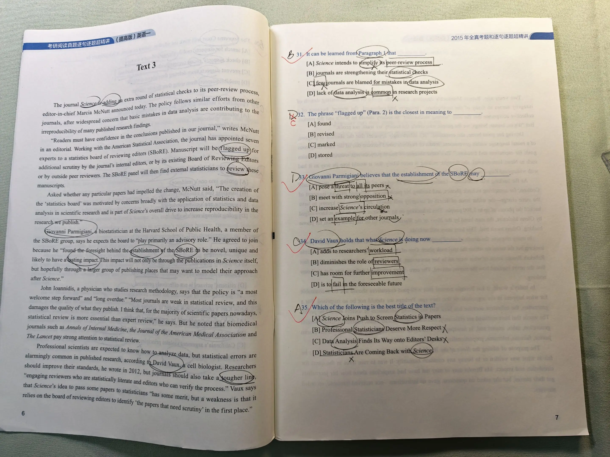
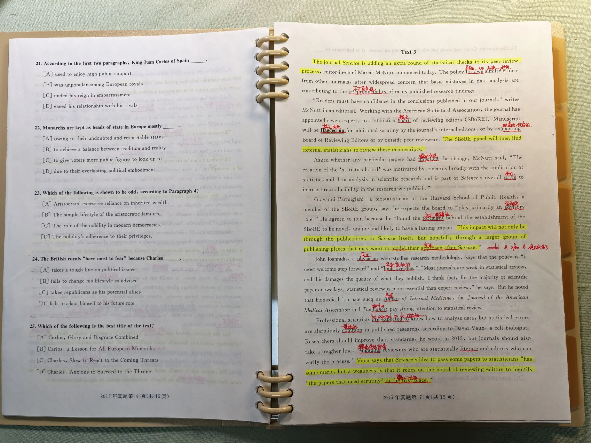
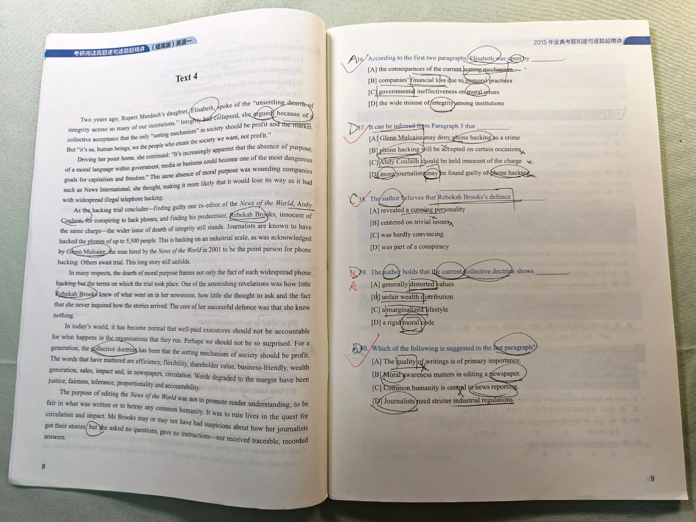
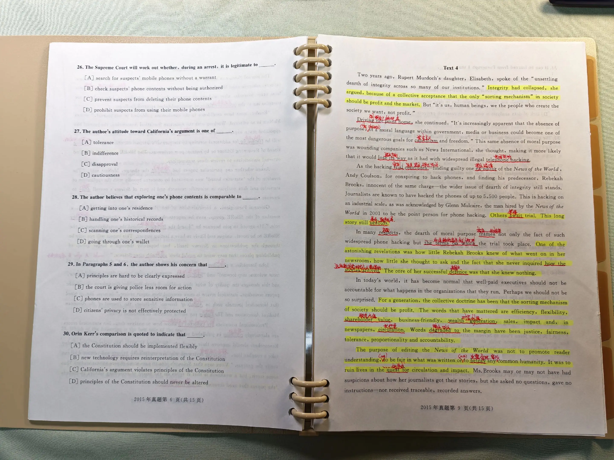

# 英语一 · 真题 · 2015年 · 阅读

[返回主页](../../../../README.md)

### 2015年英一Text1 5/5

发布于：2026-09-27（北京时间，非作答日期）  
[原作品](https://www.douyin.com/note/7690234098153580017)

原标题全文：

> 2015年英一Text1 5/5。#考研 #考研上岸 #英一 #英一阅读

### 2015年Text2 4/5

发布于：2026-09-29（北京时间，非作答日期）  
[原作品](https://www.douyin.com/note/7690975380724221553)

原标题全文：

> 2015年Text2 4/5。#考研 #考研上岸 #英一

### 2015年Text3 4/5

发布于：2026-09-30（北京时间，非作答日期）  
[原作品](https://www.douyin.com/note/7691314803842851707)

原标题全文：

> 2015年Text3 4/5。#考研 #考研上岸 #英一

### 2015年英一Text4 4/5

发布于：2026-10-01（北京时间，非作答日期）  
[原作品](https://www.douyin.com/note/7691728098379007857)

原标题全文：

> 2015年英一Text4 4/5。#考研 #考研上岸 #英一

