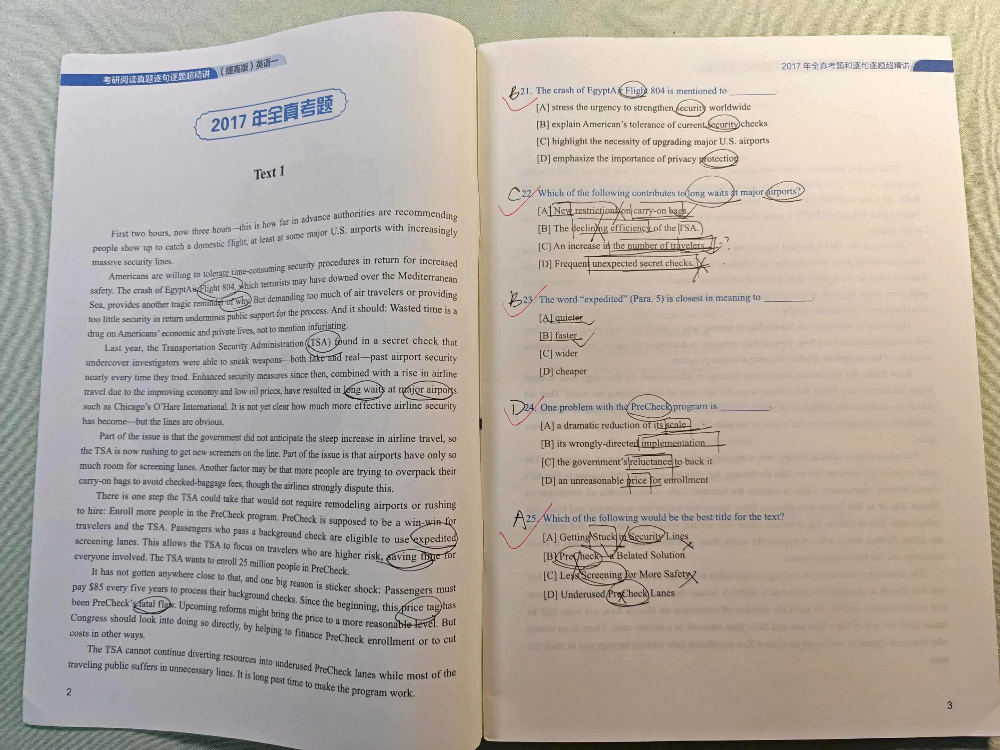
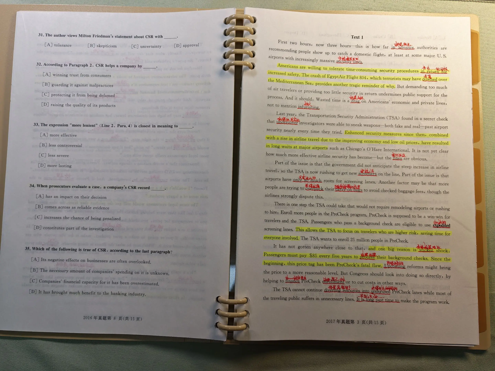
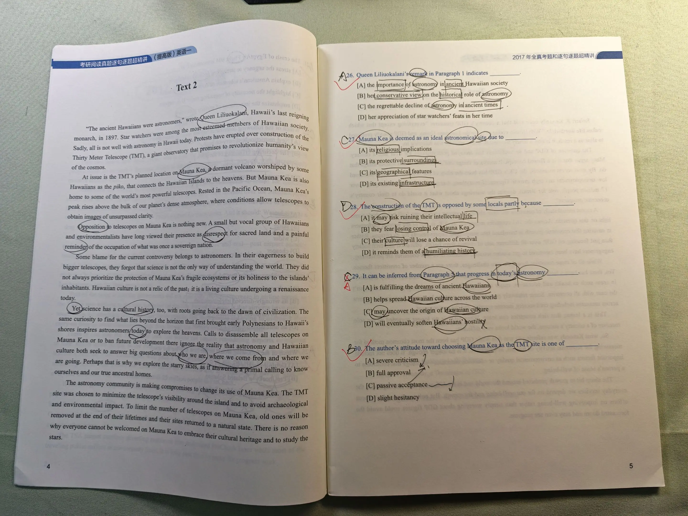
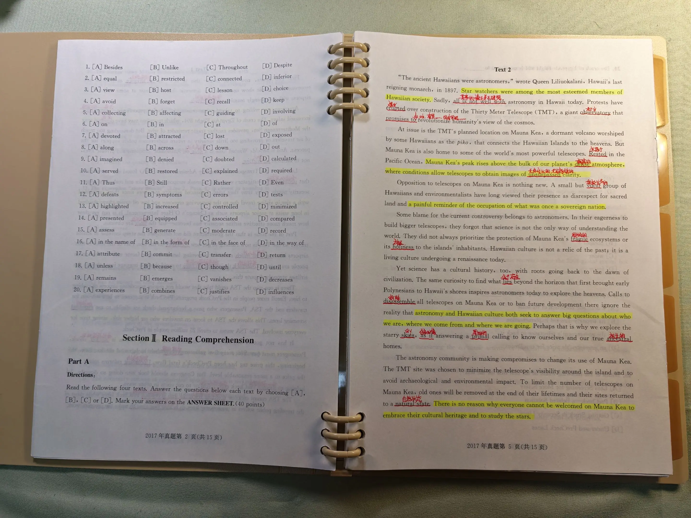
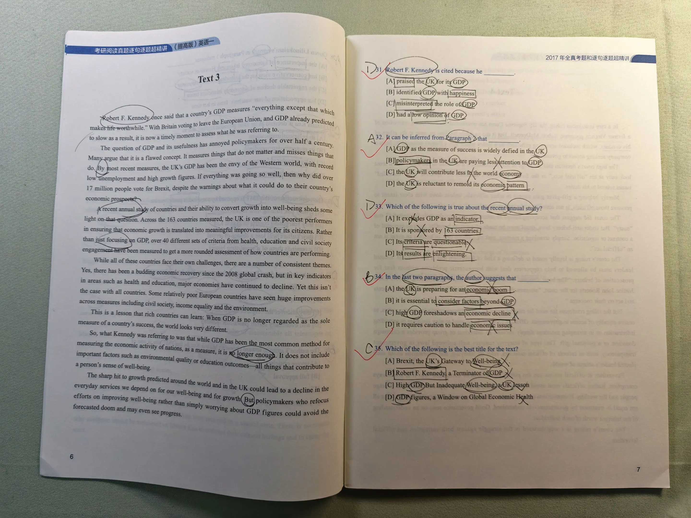
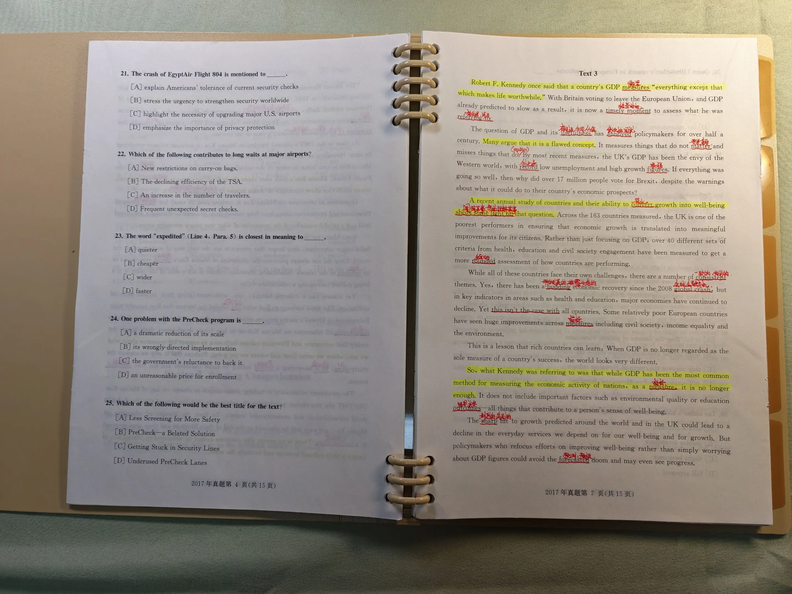
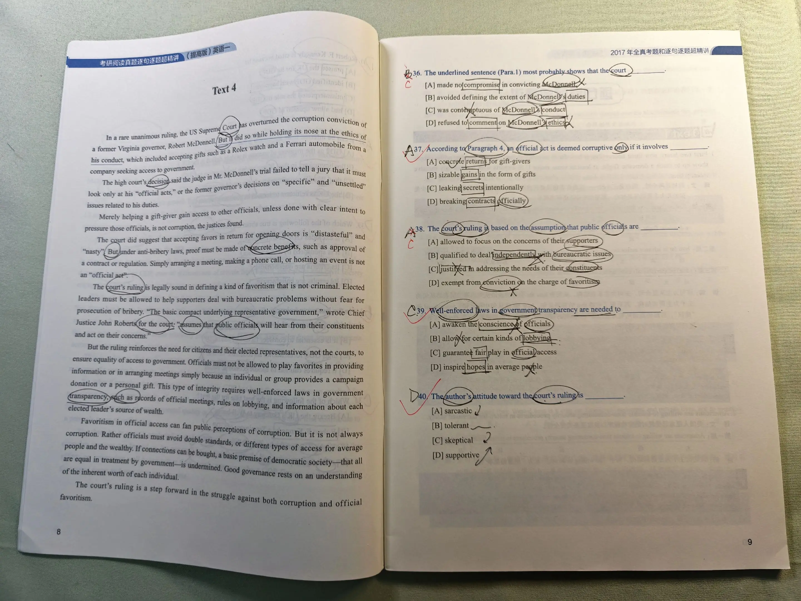
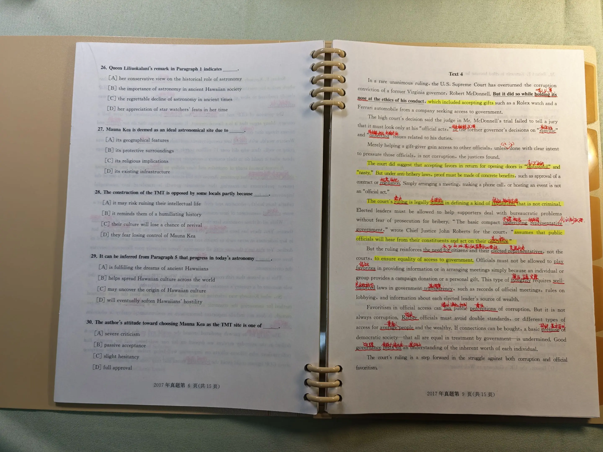

# 英语一 · 真题 · 2017年 · 阅读

[返回主页](../../../../README.md)

### 2017年英一Text1 5/5

发布于：2026-10-10（北京时间，非作答日期）  
[原作品](https://www.douyin.com/note/7695035154935341169)

原标题全文：

> 2017年英一Text1 5/5。#考研 #考研上岸 #英一

### 2017年英一Text2 4/5

发布于：2026-10-11（北京时间，非作答日期）  
[原作品](https://www.douyin.com/note/7695420392781436273)

原标题全文：

> 2017年英一Text2 4/5。#考研 #考研上岸 #英一

### 2017年英一Text3 5/5

发布于：2026-10-13（北京时间，非作答日期）  
[原作品](https://www.douyin.com/note/7696136771269575665)

原标题全文：

> 2017年英一Text3 5/5。#考研 #考研上岸 #英一

### 2017年英一Text4 3/5

发布于：2026-10-14（北京时间，非作答日期）  
[原作品](https://www.douyin.com/note/7696535254245681339)

原标题全文：

> 2017年英一Text4 3/5。#考研 #考研上岸 #英一

