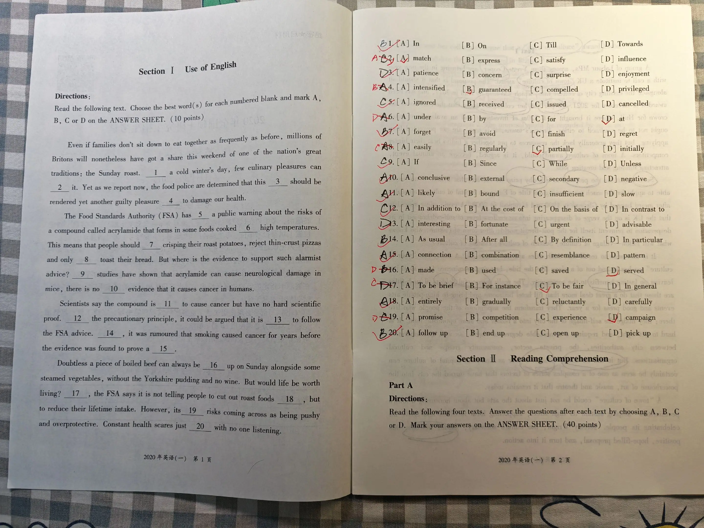
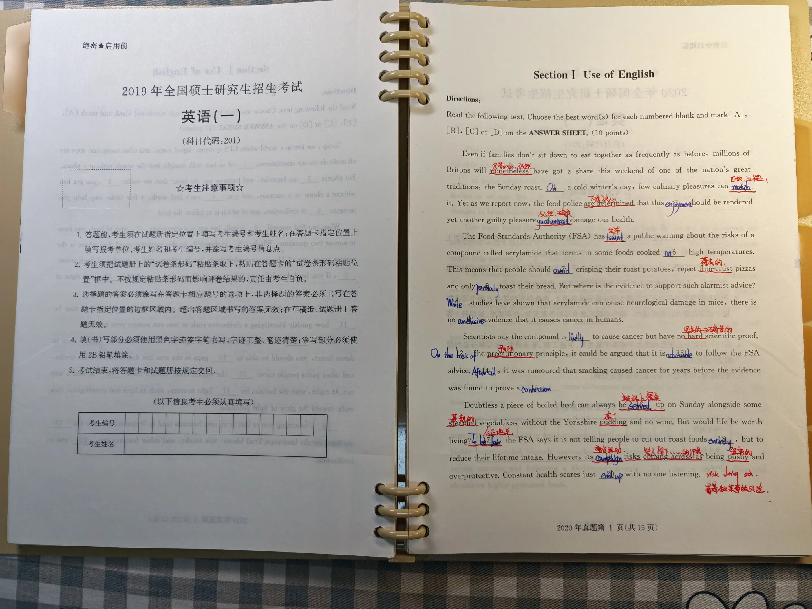
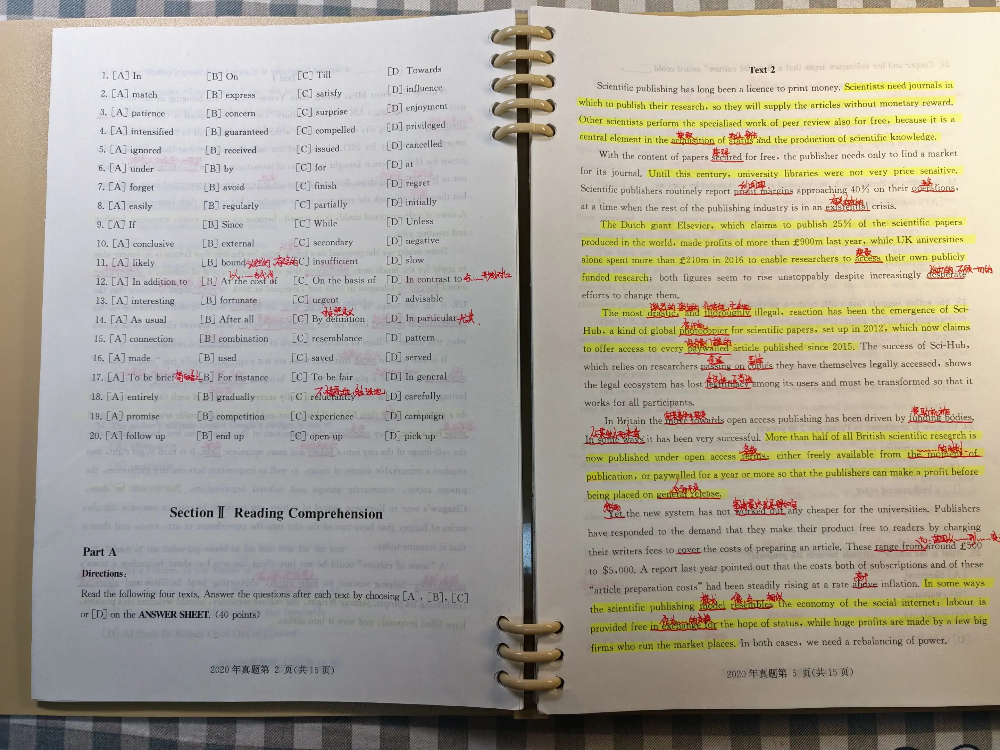

# 英语一 · 真题 · 2020年 · 完形填空

[返回主页](../../../../README.md)

### 2020年英一完形填空 13/20

发布于：2026-11-27（北京时间，非作答日期）  
[原作品](https://www.douyin.com/note/7712849646078894257)

原标题全文：

> 2020年英一完形填空 13/20。#考研 #考研上岸 #英一

