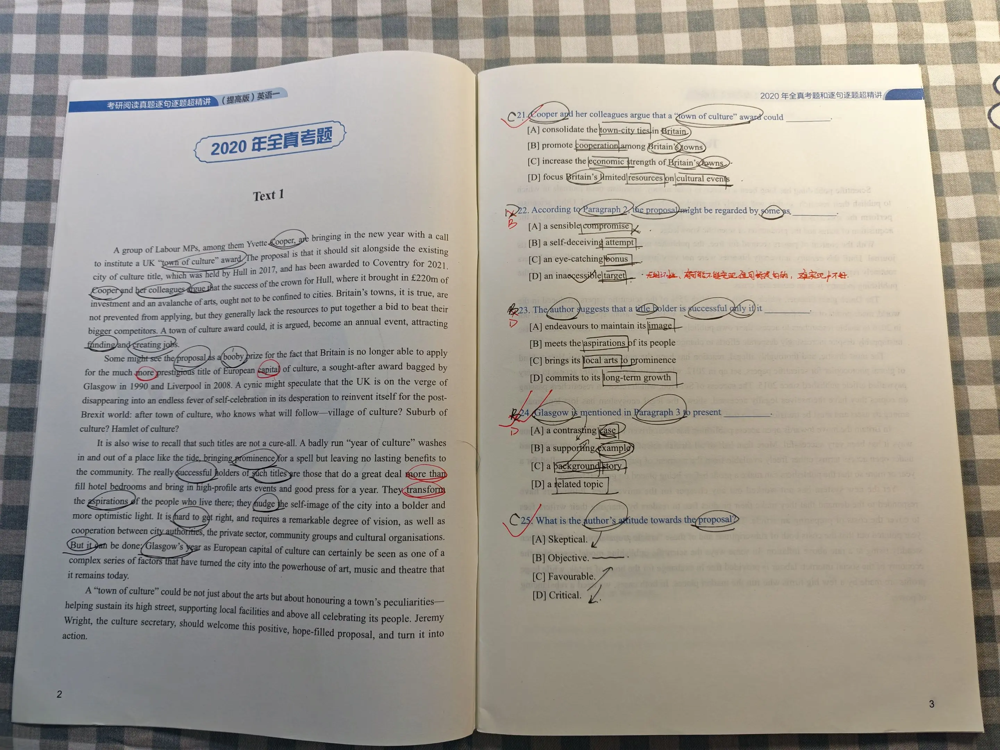
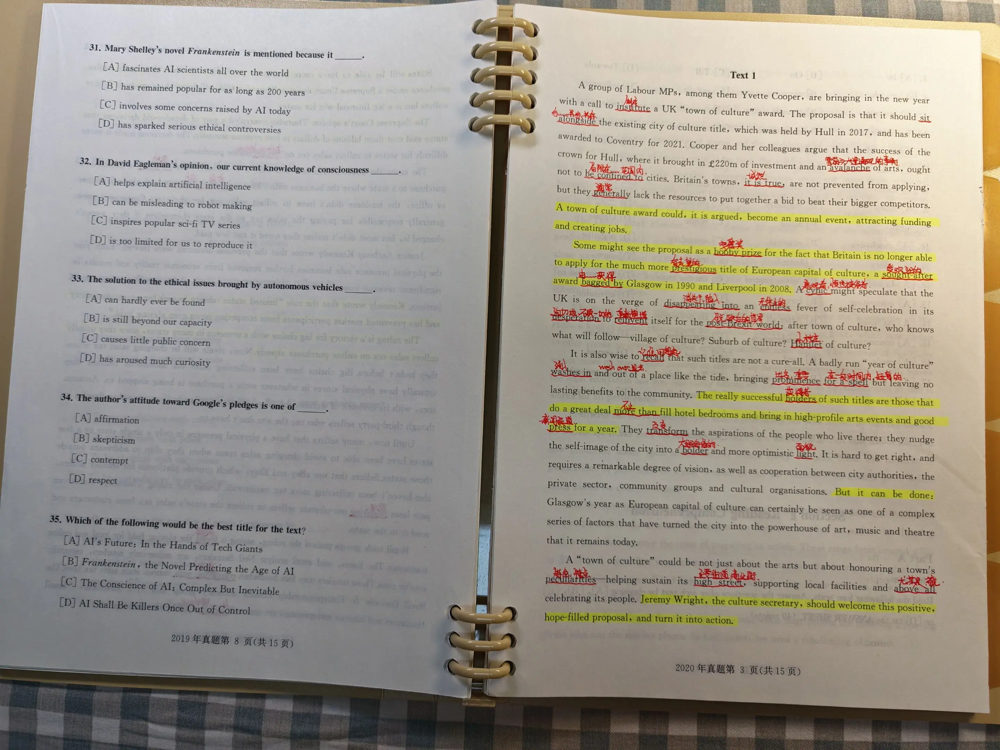
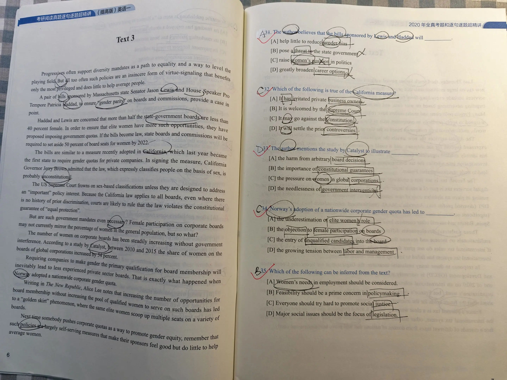
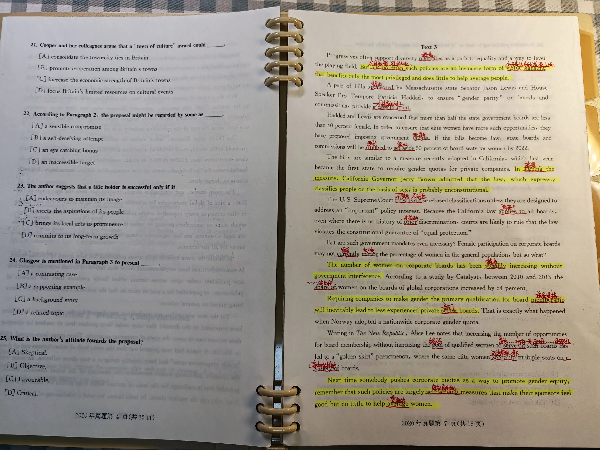
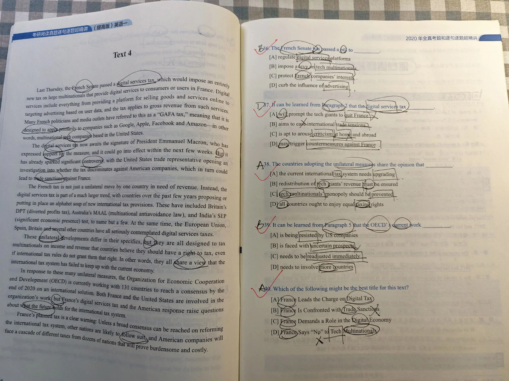
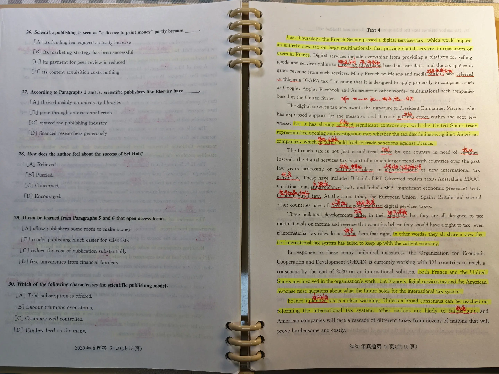
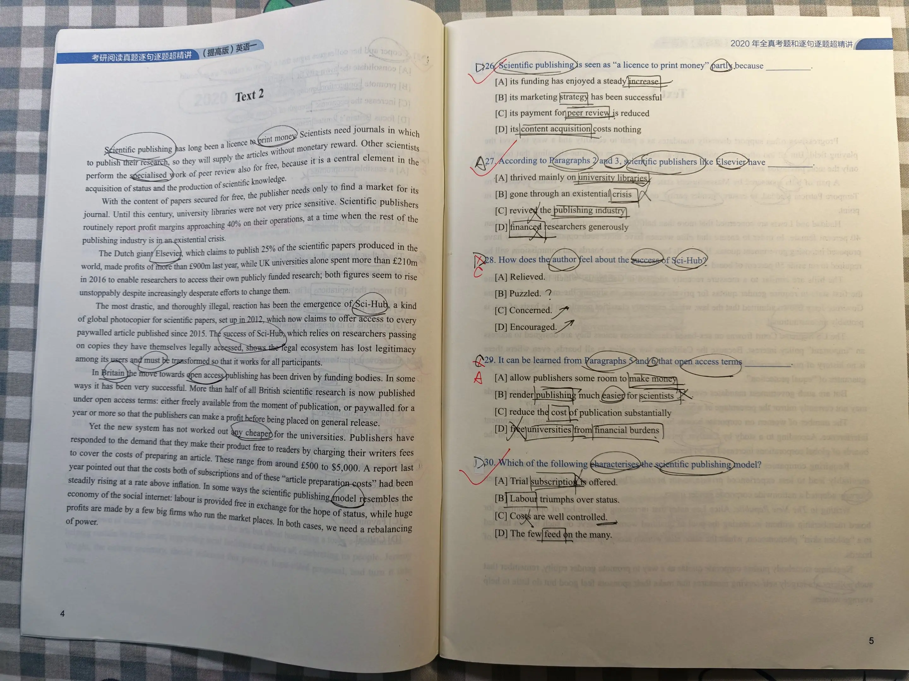
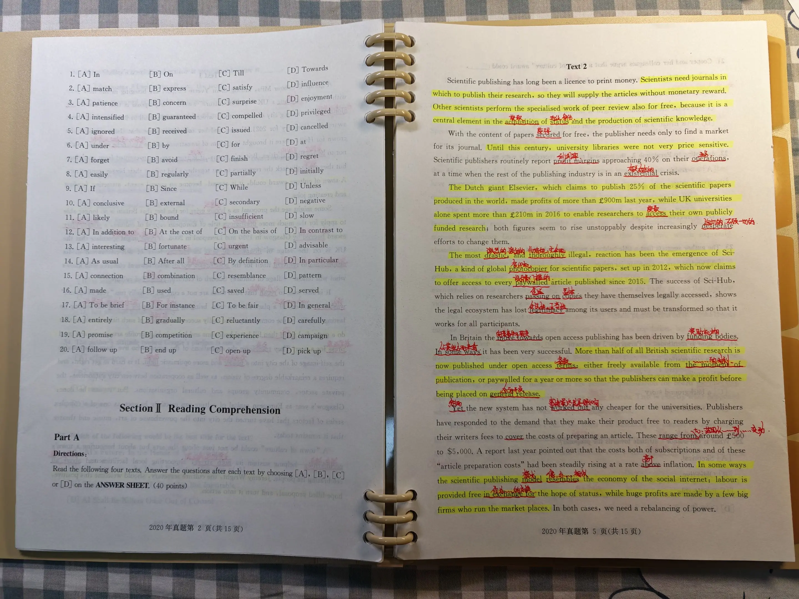
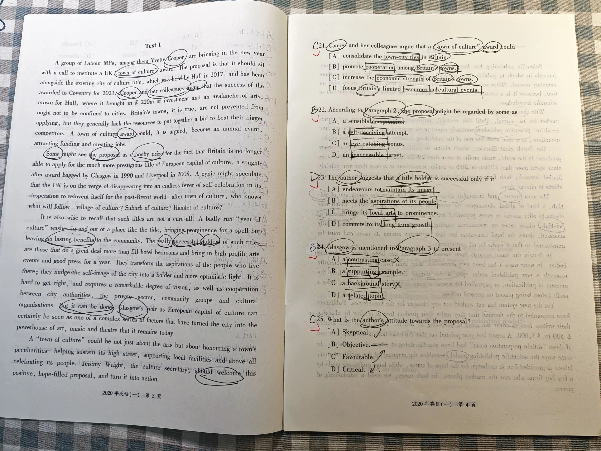
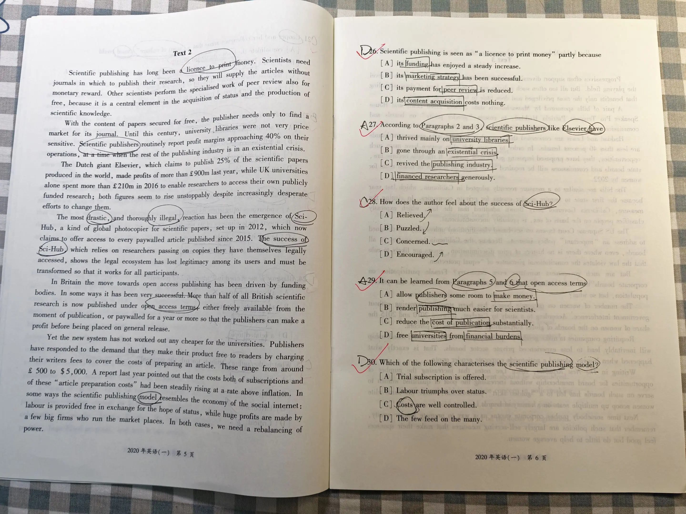

# 英语一 · 真题 · 2020年 · 阅读

[返回主页](../../../../README.md)

### 2020年英一Text1 3/5

发布于：2026-10-25（北京时间，非作答日期）  
[原作品](https://www.douyin.com/note/7700590959612386981)

原标题全文：

> 2020年英一Text1 3/5。#考研 #考研上岸 #英一

### 2020年英一Text3 5/5

发布于：2026-10-27（北京时间，非作答日期）  
[原作品](https://www.douyin.com/note/7701346916382722481)

原标题全文：

> 2020年英一Text3 5/5。#考研 #考研上岸 #英一

### 2020年英一Text4 5/5

发布于：2026-10-27（北京时间，非作答日期）  
[原作品](https://www.douyin.com/note/7701347056534928613)

原标题全文：

> 2020年英一Text4 5/5。#考研 #考研上岸 #英一

### 2020年英一Text2 3/5

发布于：2026-10-28（北京时间，非作答日期）  
[原作品](https://www.douyin.com/note/7701703277100795493)

原标题全文：

> 2020年英一Text2 3/5。#考研 #考研上岸 #英一

### 2020年英一Text1 5/5

发布于：2026-11-27（北京时间，非作答日期）  
[原作品](https://www.douyin.com/note/7712851640307687674)

原标题全文：

> 2020年英一Text1 5/5。#考研 #英一

### 2020年英一Text2 5/5

发布于：2026-11-27（北京时间，非作答日期）  
[原作品](https://www.douyin.com/note/7712851789025397157)

原标题全文：

> 2020年英一Text2 5/5。#考研 #考研上岸 #英一 #二刷

