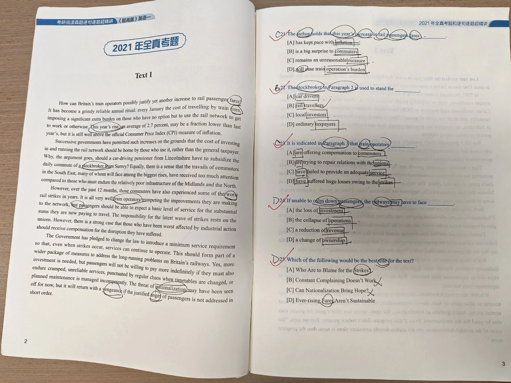
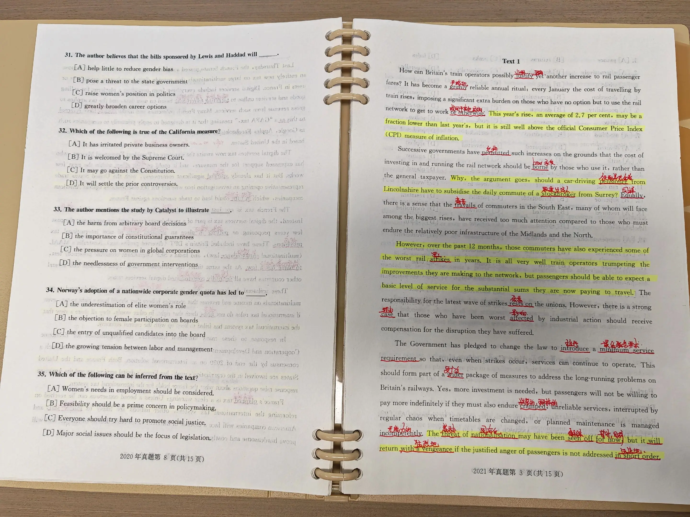
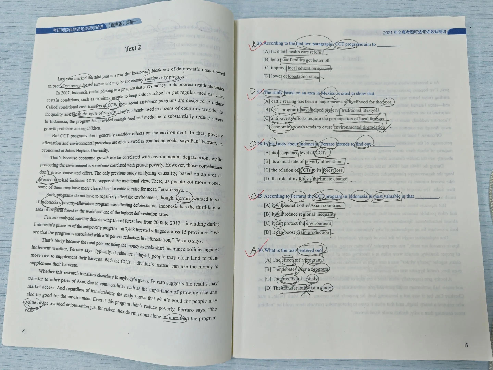
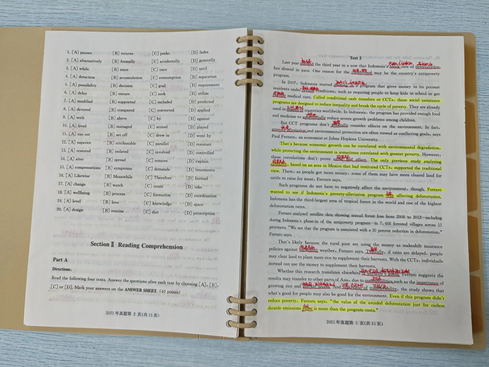
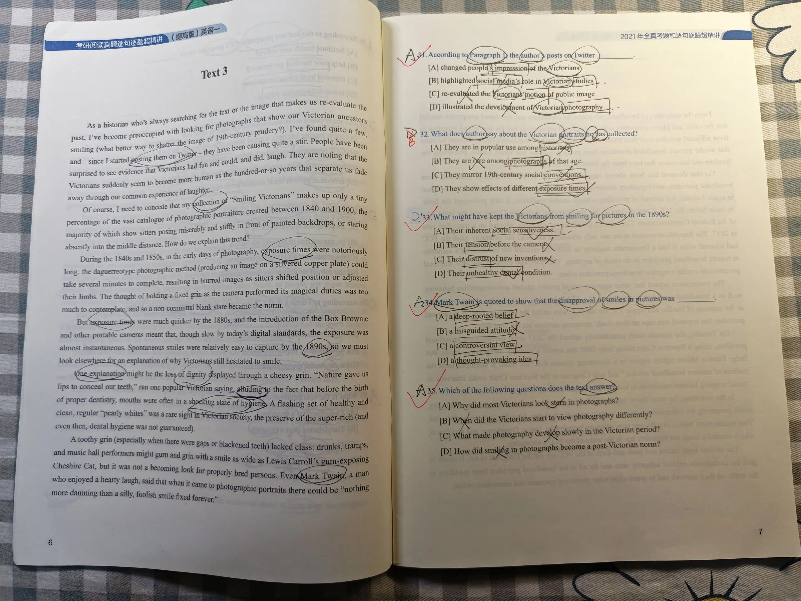
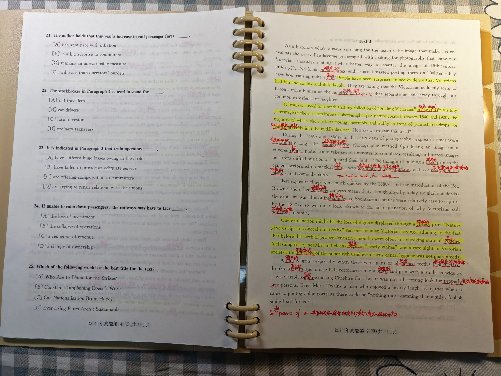
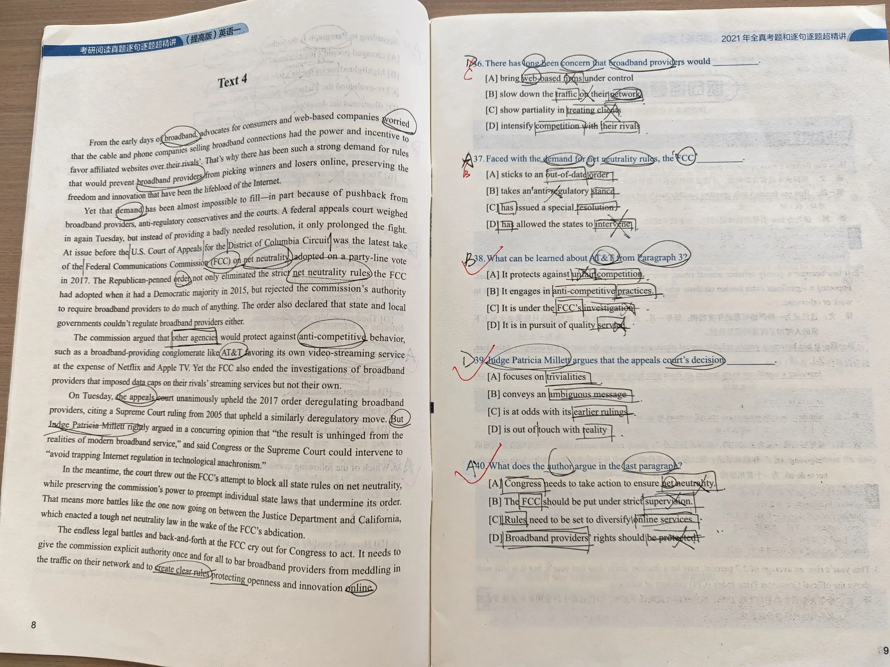
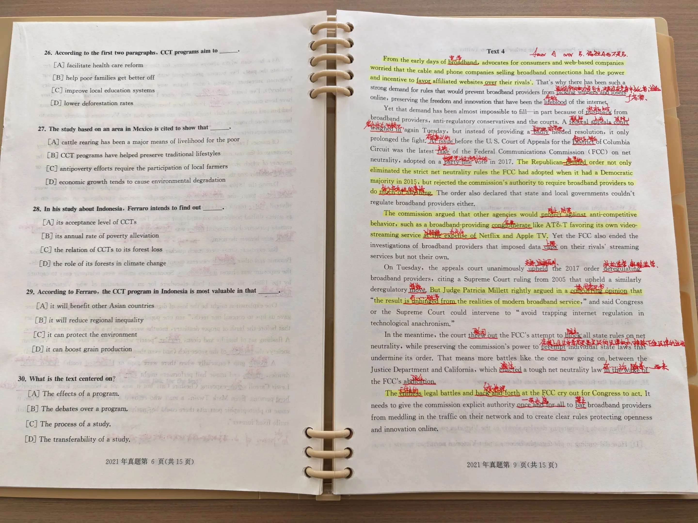

# 英语一 · 真题 · 2021年 · 阅读

[返回主页](../../../../README.md)

### 2021年英一Text1 5/5

发布于：2026-10-29（北京时间，非作答日期）  
[原作品](https://www.douyin.com/note/7702016384469977763)

原标题全文：

> 2021年英一Text1 5/5。#考研 #考研上岸 #英一

### 2021年英一Text2 5/5

发布于：2026-10-31（北京时间，非作答日期）  
[原作品](https://www.douyin.com/note/7702770183254296442)

原标题全文：

> 2021年英一Text2 5/5。#考研 #考研上岸 #英一

### 2021年英一Text3 4/5

发布于：2026-11-01（北京时间，非作答日期）  
[原作品](https://www.douyin.com/note/7703203719672291707)

原标题全文：

> 2021年英一Text3 4/5。#考研 #考研上岸 #英一

### 2021年英一Text4 3/5

发布于：2026-11-04（北京时间，非作答日期）  
[原作品](https://www.douyin.com/note/7704115841067930353)

原标题全文：

> 2021年英一Text4 3/5。#考研 #考研上岸 #英一

