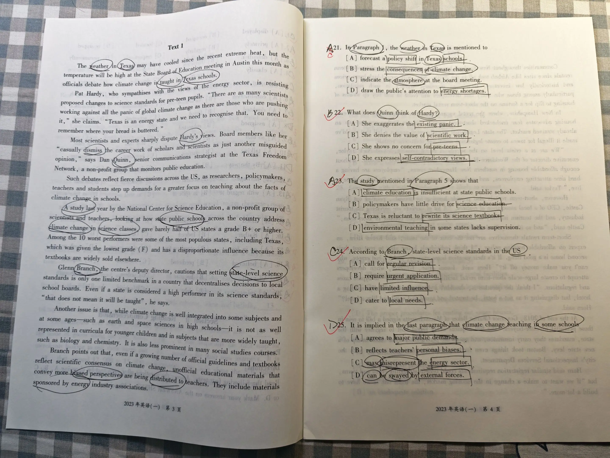
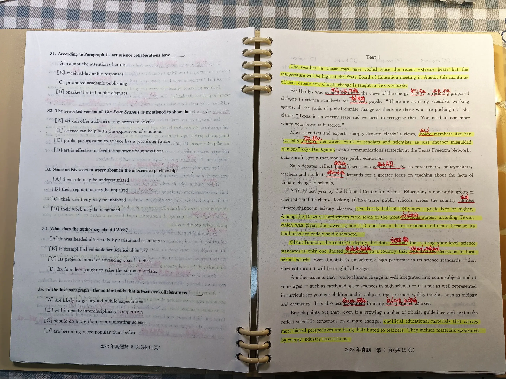
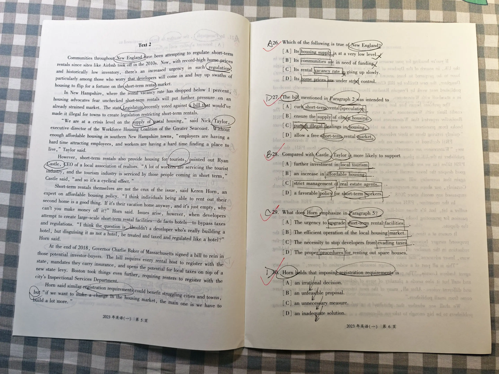
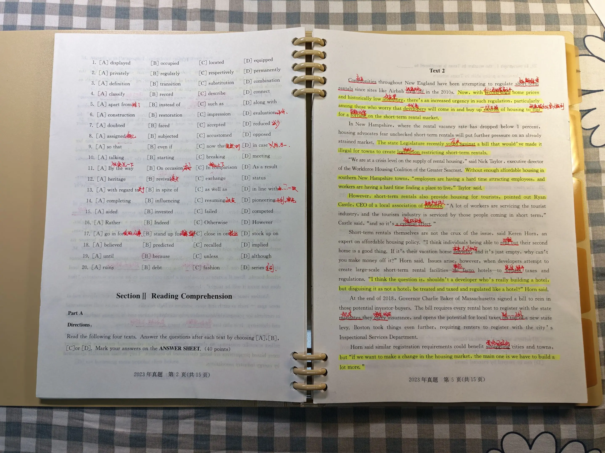
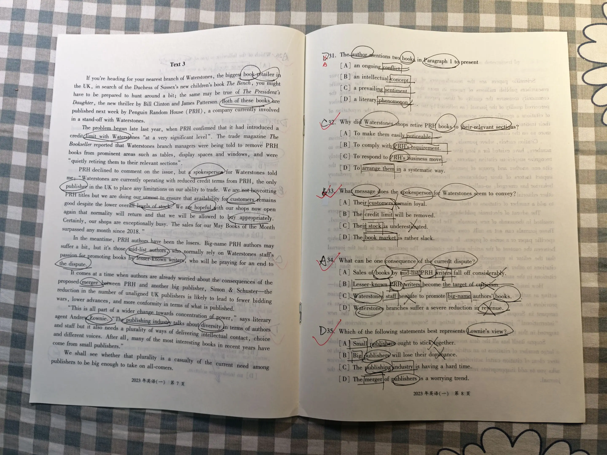
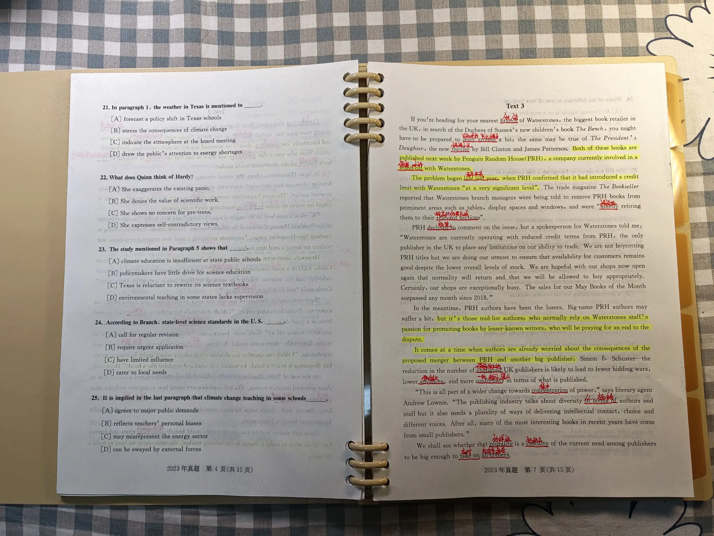
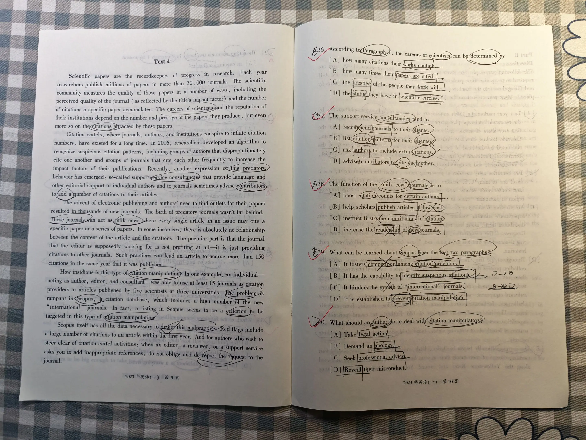
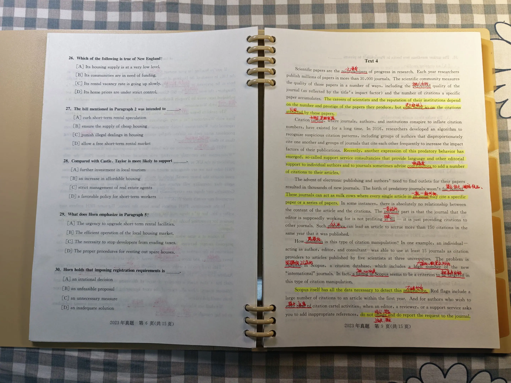

# 英语一 · 真题 · 2023年 · 阅读

[返回主页](../../../../README.md)

### 2023年英一Text1 4/5

发布于：2026-11-11（北京时间，非作答日期）  
[原作品](https://www.douyin.com/note/7706906490120798178)

原标题全文：

> 2023年英一Text1 4/5。#考研 #考研上岸 #英一

### 2023年英一Text2 5/5

发布于：2026-11-12（北京时间，非作答日期）  
[原作品](https://www.douyin.com/note/7707276954425065713)

原标题全文：

> 2023年英一Text2 5/5。#考研 #考研上岸 #英一

### 2023年英一Text3 4/5

发布于：2026-11-13（北京时间，非作答日期）  
[原作品](https://www.douyin.com/note/7707664582155716081)

原标题全文：

> 2023年英一Text3 4/5。#考研 #考研上岸 #英一

### 2023年英一Text4 5/5

发布于：2026-11-17（北京时间，非作答日期）  
[原作品](https://www.douyin.com/note/7709117708982562938)

原标题全文：

> 2023年英一Text4 5/5。#考研 #考研上岸 #英一

